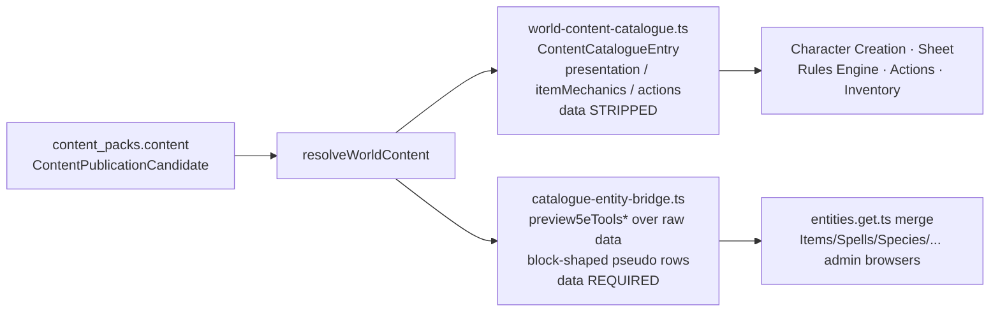
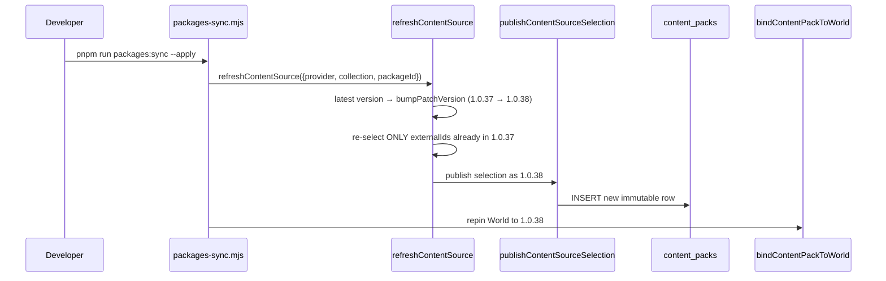
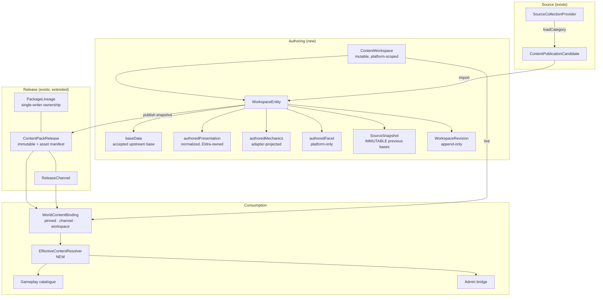
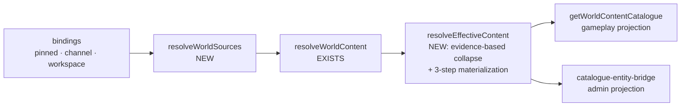
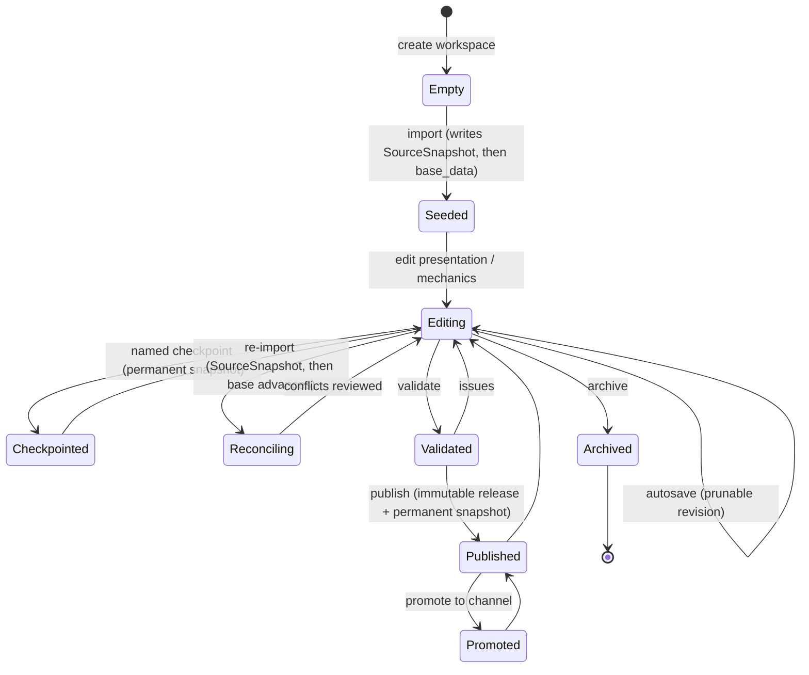
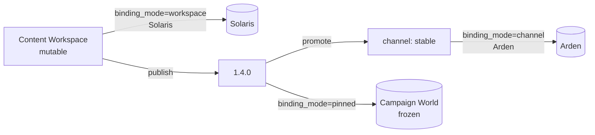
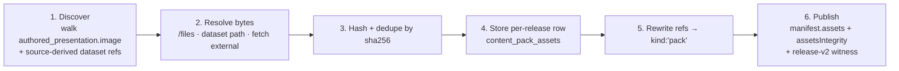
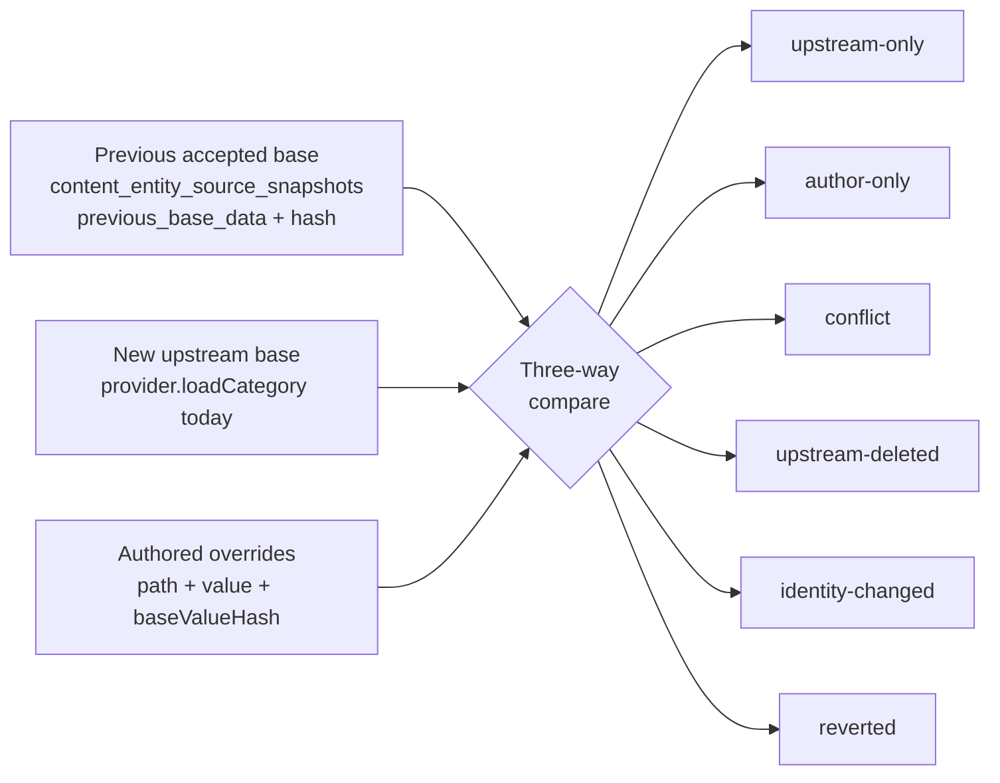
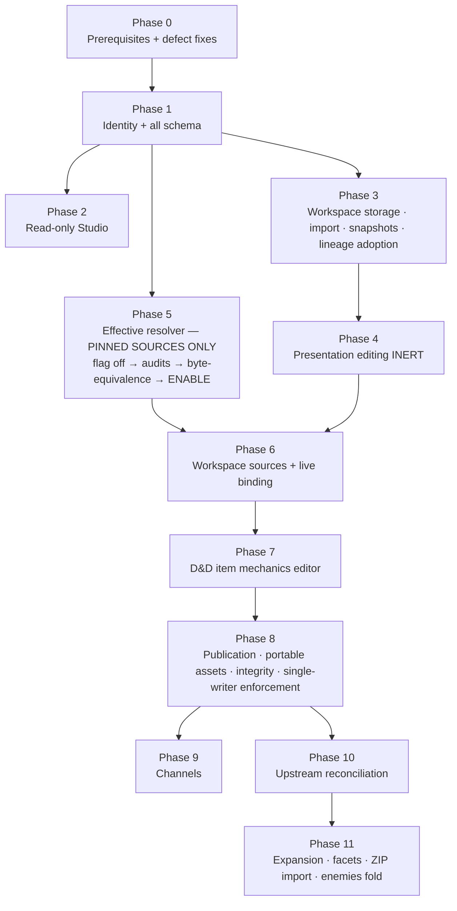

# Eldra Content Workspaces & Content Studio

**Status:** Design **approved subject to the corrections recorded in this revision.** Not
implemented. No application code, schema, API, or tests in this pass.

**Revision 2.** Incorporates an architecture review that corrected nine areas: legacy identity
scoping, the `base_data` lifecycle, presentation normalization, phase ordering, package-lineage
single-writer ownership, published asset integrity, the ten open product questions (now resolved),
Phase 0 scope, and slug-change controls. Where this revision reverses Revision 1, the reversal is
called out inline as **[Revised]** so a reader of the earlier draft can see what moved and why.

**Scope.** The authoring axis of Eldra's content system — how content becomes editable, how edits
resolve into one effective entity, how edits become reusable releases, and what Game Admin UI owns
that lifecycle.

**Relationship to existing documents.** This is a sibling of
[content-source-architecture.md](content-source-architecture.md), which owns the
*source → candidates* axis (providers, importers, preview, publish orchestration) and remains
accurate. This document owns the *candidates → workspace → effective entity → release* axis and
resolves three items that document deferred:

| Deferred there | Resolved here |
| --- | --- |
| §11.2 Cross-pack precedence at resolution time | [§8 Effective resolution and precedence](#8-effective-resolution-and-precedence) |
| §11.6 Re-import and three-way merge | [§16 Upstream reconciliation](#16-upstream-reconciliation) |
| §11.7 Draft packs ("curation currently lives only in browser memory") | [§9 Workspace, revision, and release lifecycle](#9-workspace-revision-and-release-lifecycle) |

The repository convention is one focused document per architectural axis. Cross-references are used
instead of folding this into the import-pipeline document. Assumed as context:
[ownership-and-permissions.md](ownership-and-permissions.md),
[rules-package-architecture.md](rules-package-architecture.md).

---

## Table of contents

1. [Executive decision](#1-executive-decision)
2. [Verified current-state architecture](#2-verified-current-state-architecture)
3. [Problems and non-negotiable requirements](#3-problems-and-non-negotiable-requirements)
4. [Options considered and rejected](#4-options-considered-and-rejected)
5. [Proposed domain model](#5-proposed-domain-model)
6. [Proposed storage and schema model](#6-proposed-storage-and-schema-model)
7. [Canonical identity rules](#7-canonical-identity-rules)
8. [Effective resolution and precedence](#8-effective-resolution-and-precedence)
9. [Workspace, revision, and release lifecycle](#9-workspace-revision-and-release-lifecycle)
10. [Binding modes](#10-binding-modes)
11. [Package lineage ownership and the single-writer invariant](#11-package-lineage-ownership-and-the-single-writer-invariant)
12. [Content Studio UX](#12-content-studio-ux)
13. [Media portability and asset integrity](#13-media-portability-and-asset-integrity)
14. [Permission model](#14-permission-model)
15. [Character and reference behavior](#15-character-and-reference-behavior)
16. [Upstream reconciliation](#16-upstream-reconciliation)
17. [Migration and backward compatibility](#17-migration-and-backward-compatibility)
18. [Phased implementation plan](#18-phased-implementation-plan)
19. [Test strategy and acceptance criteria](#19-test-strategy-and-acceptance-criteria)
20. [Operational risks and rollback](#20-operational-risks-and-rollback)
21. [Resolved product decisions](#21-resolved-product-decisions)
22. [Continuation checkpoint](#22-continuation-checkpoint)

---

# 1. Executive decision

**Adopt mutable Content Workspaces as the authoring source of truth, in new storage, alongside —
never inside — the existing immutable `content_packs` release table.** Worlds bind a live workspace,
a release channel, or a pinned release. Authored entities collapse with their base **only on
explicit equivalence evidence**, so the catalogue exposes exactly one effective entity per logical
identity without ever guessing that two packages' matching slugs mean the same thing.

Seven decisions carry the design:

1. **New tables, not reuse.** `entities` is hard-scoped to one World (`entities.world_id → worlds`,
   "owning world"), making a cross-World library impossible by construction. `content_packs` rows
   are immutable by an invariant characters depend on — `publishContentPackRelease`
   ([server/utils/content-packs.ts:495](../../../server/utils/content-packs.ts)) refuses any write
   to an existing `(package_id, version)`, and no update or delete function exists in the module.

2. **Identity is explicit, never inferred.** **[Revised]** A legacy entry without a
   `contentEntityId` is addressed **lineage-scoped**: `packageId :: systemKey :: entityType :: slug`.
   Cross-package collapse requires declared evidence (`contentEntityId`, `curatedFrom`, a stored
   `baseRefs` equivalence, a lineage `supersedes` relation, or a lineage-scoped slug alias). Matching
   slug, title, or name-derived `externalId` is **never** sufficient. Consequence: with no declared
   equivalences, the new resolver is a **pure identity function** over today's behavior
   ([§8.7](#87-the-legacy-no-op-theorem)).

3. **One accepted base, plus immutable source snapshots.** **[Revised]** `base_data` is the
   *currently accepted upstream base* and advances on accepted import. Every import writes an
   immutable `content_entity_source_snapshots` row **before** it advances, so the previous base is
   never destroyed and three-way reconciliation stays possible forever
   ([§9.2](#92-what-is-immutable-what-advances-what-is-pruned)).

4. **Authored presentation is Eldra-owned and normalized.** **[Revised]** Content Studio never reads
   or writes provider-specific raw structures such as 5etools `fluff.images`. Universal authored
   fields live in an `AuthoredPresentation` shaped like the existing `PresentationEntry`, merged over
   the source-resolved presentation at read time ([§7.6](#76-the-three-override-channels),
   [§8.5](#85-materialization-three-distinct-steps)).

5. **Releases stay immutable and become self-contained snapshots**, with integrity now covering
   content, canonical manifest core, **and the ordered asset-hash list** under a versioned witness
   scheme that leaves every existing pack's hash verifiable unchanged ([§13.4](#134-release-integrity-witness)).

6. **One writer per package lineage.** **[New]** Once a workspace adopts a `packageId`, it is the
   sole publisher for that lineage; `refreshContentSource`/`packages:sync` are refused for it with
   an explicit explanation, and remain fully available for unadopted lineages ([§11](#11-package-lineage-ownership-and-the-single-writer-invariant)).

7. **The resolver is proven before it receives mutable sources.** **[Revised]** Effective resolution
   is built and enabled against pinned releases only (Phase 5); workspace sources and live binding
   arrive afterwards (Phase 6). No phase claims independent deployability if enabling it would show
   duplicates ([§18](#18-phased-implementation-plan)).

Where verified code changed the direction: [§2.9](#29-where-the-code-contradicted-or-refined-the-brief).

---

# 2. Verified current-state architecture

Every claim below was read from the working tree. Paths and names are as they exist today.

## 2.1 Publication contract and identity

[server/utils/content-pack-publishing.ts](../../../server/utils/content-pack-publishing.ts)

```ts
export type ContentPublicationCandidate = {
  systemKey: string
  entityType: string
  title: string
  slug: string
  externalId: string
  provider: string
  sourceBook?: string
  sourcePage?: string
  data: unknown            // opaque above the resolvers
  rulesFacet?: RulesFacet  // published fact, relayed never recomputed
  parentClassSlug?: string // subclass only
  definitionId?: string    // featureOption only
}
```

- `candidateIdentityKey()` = `` `${systemKey}::${entityType}::${slug}` `` — used **only** for
  duplicate detection *within one pack* at publish time (`validateContentPackForPublication`). It has
  never been, and must not become, a cross-package identity.
- `externalId` is required but participates in no uniqueness check. It is the provenance key and the
  key `refreshContentSource` re-selects by — a *within-lineage* matching key, not an identity.
- `rulesFacet`, `parentClassSlug`, `definitionId` were each added later and are absent on every
  previously published pack. **This is the precedent for the additive candidate evolution this
  design depends on.**

## 2.2 Release storage and immutability

[server/utils/content-packs.ts](../../../server/utils/content-packs.ts),
[scripts/directus/create-content-packs-schema.mjs](../../../scripts/directus/create-content-packs-schema.mjs)

`content_packs`: `id (uuid)`, `package_id`, `version`, `status`, `content_schema_version`, `title`,
`integrity_hash`, `license_id`, `created_at`, `manifest (json)`, `content (json)`.

- `(package_id, version)` uniqueness is **application-level only** (Directus's Fields API has no
  composite-unique primitive); enforced by a read-then-insert in `publishContentPackRelease`.
- `computeContentIntegrityHash(content)` = `sha256(canonicalize(content))`. **The manifest is not
  hashed, and assets do not exist.** Both facts are load-bearing in [§13.4](#134-release-integrity-witness).
- Three loaders: `listPublishedContentPacks` (metadata + manifest), `loadContentPackManifest`
  (manifest only, no integrity check), `loadPublishedContentPack` (full, integrity-verified, cached
  by `${packageId}@${version}#${integrityHash}`).
- `status` is always written `'published'`. `'draft'` exists in the type and schema note and is
  **dead code**.
- **Latent bug:** `listPublishedContentPacks` sorts `['package_id', '-version']` on a varchar column,
  i.e. lexicographically — `"1.0.9"` sorts above `"1.0.38"`. `refreshContentSource` is unaffected
  (it has its own numeric `compareVersions`).

## 2.3 World binding

[server/utils/world-content-packs.ts](../../../server/utils/world-content-packs.ts),
[server/utils/world-content-pack-binding.ts](../../../server/utils/world-content-pack-binding.ts)

`world_content_pack_bindings`: one row per `(world_id, package_id)` with a **pinned**
`package_version` and a `package_integrity` witness. Many packages per World; repin updates in place;
unbind deletes the row, never the pack. `bindContentPackToWorld` performs no verification of its own
— `loadPublishedContentPack`'s status + integrity check *is* the gate — and throws loudly on an empty
`packageId`/`version` after a real production incident where a plain-JS caller passed `undefined`.

`listContentPackBindingsForWorld` sorts `['package_id']`: **today's resolution order is alphabetical
packageId, accidental rather than designed.**

## 2.4 Runtime resolution — flat concatenation, zero merge

[server/utils/world-content-runtime.ts](../../../server/utils/world-content-runtime.ts)

```ts
for (const binding of bindings) {
  const result = await loadPublishedContentPack(binding.packageId, binding.packageVersion)
  if (!result.ok) { packs.push({ ok: false, ... }); continue }
  for (const rawEntry of result.package.content) {
    entries.push({ ...rawEntry, packageId: pack.packageId, packageVersion: pack.version })
  }
}
```

**No dedup, no precedence, no override, no identity comparison exists in this layer.** Two bound
packs containing the same logical entity produce two entries. A failed pack is recorded
`{ok: false}` and stays visible. Every override mechanism in this design is new construction.

## 2.5 Catalogue projection

[server/utils/world-content-catalogue.ts](../../../server/utils/world-content-catalogue.ts)

`getWorldContentCatalogue` builds nine categories — `species`, `classes`, `backgrounds`, `feats`,
`items`, `spells`, `monsters`, `subclasses`, `featureOptions` (`ENTITY_TYPE_TO_CATEGORY`). Per entry,
**at read time from `data`**, it computes `presentation` (for species, classes, backgrounds, spells,
featureOptions, items), `actions`, `spellMechanics`, `featMechanics`, `itemMechanics`,
`attunementRequired`; it **relays** `rulesFacet` verbatim; it then **strips `data`**.

The presentation entry point is
`resolveContentPresentation(systemKey, kind, data): PresentationEntry | null`
([app/lib/content-presentation/index.ts:29](../../../app/lib/content-presentation/index.ts)), and:

```ts
export type PresentationEntry = {
  kind: PresentationKind
  name: string
  sourceBook?: string
  sourcePage?: string
  description: string[]
  facts: PresentationFact[]
  sections: PresentationSection[]
  notes: string[]
  image?: PresentationImage | null
}
```

**This already-shipped, system-agnostic shape is what [§7.6](#76-the-three-override-channels) adopts
as the authored presentation surface** — the single largest reuse in the design, because authored
presentation then needs no new consumer anywhere.

## 2.6 The two divergent projections



[server/utils/catalogue-entity-bridge.ts](../../../server/utils/catalogue-entity-bridge.ts) exists
because the six admin browsers read the legacy `entities` collection, which imported content no
longer populates. It re-runs `preview5eToolsItems/Spells/Species/Classes/Feats` over a resolved
entry's raw `data` to synthesize `.blocks`, tags rows `__source: 'catalogue'`, and gives them the
transient id `catalogue:${packageId}:${slug}` (`catalogueTemplateId`).

The admin card/rail mismatch fixed immediately before this design was **one symptom with a different
root cause from the Character Sheet gap**:

- *Character Sheet*: the catalogue layer never computed `presentation`/`itemMechanics` for `items`.
  Fixed server-side.
- *Admin browser*: `entities.get.ts` summary mode omits `.blocks` but ships pre-computed
  `collectionMetaLines`; the card read those, the rail re-derived from the absent `.blocks`. Fixed
  client-side (commit `5479978`), logic extracted to
  [app/lib/world-entity-collection/server-meta-lines.ts](../../../app/lib/world-entity-collection/server-meta-lines.ts).

Both are fixed; **the structural cause is not.** [§8.9](#89-the-effective-content-boundary) defines
the single boundary both projections consume.

## 2.7 Homebrew — a terminal, world-local fork

[server/utils/homebrew/index.ts](../../../server/utils/homebrew/index.ts) (1,607 lines)

`createHomebrewDraft` resolves a template from a legacy `entities` row or from a catalogue entry by
`{packageId, slug}` (`resolveCatalogueHomebrewTemplate`, re-resolving `resolveWorldContent` fresh so
a client cannot submit fabricated `data`), then **creates a new `entities` row** with
`status: 'draft'`, `homebrew_meta` and `import_source` blocks, and cloned core blocks. Seven types.

- Provenance is a **static snapshot in blocks**, never re-resolved.
- The clone is **world-local**: not reusable elsewhere, not publishable.
- **No promotion path exists** — nothing under `server/utils/content-pack*`,
  `server/utils/content-sources/`, or `server/api/content-packs/` mentions homebrew.
- `findHomebrewNameConflict` reports `source: 'content-pack'` separately — the only mutual awareness.
- The only authoring entry point from any browse page is the **Spells page**, gated
  `world.homebrew.manage`, deep-linking to `/worlds/:id/homebrew/create`
  ([worldEntityHomebrewActions.ts](../../../app/components/world/worldEntityHomebrewActions.ts)).
  Items, classes, species, backgrounds, and feats have **no edit action at all**.

## 2.8 The release explosion, mechanically explained



[refresh.ts](../../../server/utils/content-sources/refresh.ts) is explicit that a Content Pack is a
**compiled artifact** whose content depends on the current importer, current Rules Facets, and
current resolvers — **none versioned alongside the pack**. A facet gaining a grant makes every prior
pack stale, and the only remedy is `bumpPatchVersion` + republish + rebind. One permanent release row
per developer-side compiler change. `computeContentCompilationFingerprint`
([compilation-fingerprint.ts](../../../server/utils/content-sources/compilation-fingerprint.ts))
exists to *detect* staleness; nothing exists to repair it cheaply.

[content-publishing-backlog.md](content-publishing-backlog.md) records the companion gap: refresh
keeps only `externalId`s already in the last version, so a newly added category is silently excluded
and required "a MANUAL publish + rebind outside this tool."

The admin UI renders one row per version:
[AdminContentPacksPanel.vue](../../../app/components/admin/content-packs/AdminContentPacksPanel.vue)
`v-for="pack in publishedPacks"` over `GET /api/content-packs` → `listPublishedContentPacks()` →
`limit: -1`, every version, each with its own **Bind** button.

## 2.9 Where the code contradicted or refined the brief

| # | Premise | Verified reality | Consequence |
| --- | --- | --- | --- |
| 1 | "Verify that current references support the hybrid model." | Character refs are `{packageId, slug}` with **no version** (`InventoryItemRef`, `ContentRef`, `StoredChoiceRef`; `resolveSlot` matches exactly those two fields). | **The hybrid model is already the architecture.** No character data migration is required. [§15](#15-character-and-reference-behavior) |
| 2 | Media portability is about exporting to another instance. | `/api/5etools-img/[...path]` serves from the host path `/opt/eldra/datasets/5etools-img`, absent from the production container (`Dockerfile` ships `.output` only). | **Every fluff-derived image is already broken in real production.** Phase 0 must make the failure loud; Phase 8 fixes it. [§13](#13-media-portability-and-asset-integrity) |
| 3 | "Preserve the boundary so players do not gain Media Gallery access." | Upload and delete are gated `world.entity.edit`. **`GET /api/worlds/:id/media` has no capability gate**, and its Directus query filters only `type: image/*` — it is **not World-scoped**. Only the global authenticated-Principal middleware applies. | Any authenticated player can enumerate every image in the instance. Phase 0. |
| 4 | Introduce a canonical ID only after mapping existing identifiers. | `slug = slugify(name-source)` and `externalId = name__source` are **both name-derived**. Nothing survives an upstream rename. | `contentEntityId` justified, added **alongside** `{packageId, slug}`, with lineage-scoped slug aliases. [§7](#7-canonical-identity-rules) |
| 5 | Design release channels. | No channel concept exists, and `listPublishedContentPacks` cannot order versions correctly. | Channels Phase 9, columns Phase 1; the sort bug is a Phase 0 prerequisite because a channel head is a "latest" query. |
| 6 | Portrait upload might be affected by gating the gallery. | Portraits post `FormData` to `POST /api/worlds/:id/characters/:characterId/update` (`sendPortraitUpdate` in [useCharacterMutations.ts](../../../app/composables/useCharacterMutations.ts)); `CharacterPortrait.vue` only emits a `File`. **No gallery route is involved.** | Gating the gallery listing provably cannot break portraits — now a Phase 0 regression test rather than an assumption. |

---

# 3. Problems and non-negotiable requirements

## 3.1 Problems, each traced to a mechanism

| Problem | Mechanism |
| --- | --- |
| Every correction costs a permanent release | §2.8 |
| Admin list is dozens of indistinguishable rows | §2.8 |
| No in-app editing of imported content | §2.7 |
| Cannot add an image or better description to a Shortsword | §2.5 / §2.7 |
| Correcting mechanics means editing source JSON | §2.1 |
| No reusable curated library | §2.3 |
| Changes invisible without publishing | §2.3 / §2.4 |
| Reuse elsewhere means visible duplicates | §2.4 |
| Authoring is D&D-shaped | §2.6 |

## 3.2 Requirements

**R1** Published releases remain immutable, integrity-verified, append-only. Nothing updates or
deletes a `content_packs` row.

**R2** Exactly one effective entity per logical identity in every projection and UI — and **identity
is never inferred**. Distinct packages' matching slugs stay distinct.

**R3** Imported source data is preserved and recoverable. Authored values are a separate,
provenance-carrying layer; every field is individually revertible; the previous accepted upstream
base is never destroyed.

**R4** A curated release is usable in a World binding **neither** the upstream pack nor the workspace.

**R5** Ordinary players never gain Media Gallery access. (Currently *violated* for listing — §2.9/3.)

**R6** The universal authoring system contains no game-system specifics and never reads or writes
provider-specific raw JSON. Mechanics arrive through an adapter.

**R7** Source attribution and licensing survive curation, snapshotting, export, and import.

**R8** No visible duplicate entity is an acceptable MVP state.

**R9** Raw JSON is never the expected editing interface for a normal administrator.

**R10** Existing characters, bindings, releases, and homebrew entities keep working with no migration
of their stored data.

**R11** Exactly one publisher per package lineage.

**R12** Release integrity covers the actual asset bytes, not only `content`.

---

# 4. Options considered and rejected

## 4.1 Authoring source of truth

| Option | Verdict | Reason |
| --- | --- | --- |
| **A. New workspace/entity/revision/snapshot tables** | **Recommended** | Only option satisfying R1 + R4 together. Platform-scoped; leaves every existing table untouched. |
| B. Reuse `entities` + `block_instances` | Rejected | `entities.world_id → worlds` makes it world-scoped; a reusable library cannot live there (R4). Its block model is the world-wiki shape `content-pack-publishing.ts`'s header forbids in the pack pipeline. |
| C. Extend Homebrew drafts | Rejected as primary | Same world-scoping flaw, plus "clone produces a second visible record" (R2/R8). Retained as a feeder — [§9.6](#96-homebrews-future-role). |
| D. Mutable `content_packs` rows with `status: 'draft'` | Rejected | Puts mutable rows in the table whose entire value is immutability. The `'draft'` enum should be **removed**, not populated. |
| E. Overrides only, no workspace entities | Rejected | Cannot represent original authored content; cannot satisfy R4 without a base pack bound. |
| F. Git-backed content files | Rejected | Production ships `.output` only, with no writable content tree — the same failure class that left `scene_layer_objects` missing in production for weeks. |

## 4.2 Release composition

| Option | Verdict | Reason |
| --- | --- | --- |
| **Full effective snapshots** | **Recommended** | Only shape satisfying R4; `resolveWorldContent` already loads self-contained packs. |
| Patches + required dependencies | Rejected | Requires the base pack bound (violates R4); makes integrity ambiguous. |
| Hybrid: snapshot content, dependencies as *metadata* | **Adopted refinement** | `manifest.dependencies` records derivation for reconciliation and attribution, and is **never a load requirement**. |

## 4.3 Identity anchoring

| Option | Verdict | Reason |
| --- | --- | --- |
| Global `systemKey::entityType::slug` collapse (Revision 1's fallback) | **Rejected in this revision** | Two unrelated packs may both publish `dnd5e/item/dragon-blade` without meaning the same item. Matching slugs are not evidence. This was the review's Correction 1. |
| Anchor on `externalId` | Rejected for cross-package identity | Name-derived (`name__source`). Retained for *within-lineage* re-import matching only. |
| Anchor on `(packageId, slug)` alone | Rejected as identity | Breaks on repackaging, which R4 requires. Retained as the **legacy compatibility address**. |
| **`contentEntityId` for identity; lineage-scoped legacy address; cross-package collapse only on declared evidence** | **Recommended** | Survives renames and repackaging, replaces nothing, and cannot invent equivalence. |

## 4.4 Previous-base retention

| Option | Verdict | Reason |
| --- | --- | --- |
| **Dedicated `content_entity_source_snapshots`** | **Recommended** | Prune-immunity becomes **structural** rather than dependent on a correct `WHERE kind != 'import'` clause in a maintenance script; losing the only copy of a previous accepted base is unrecoverable for reconciliation. Also a distinct query shape ("latest accepted base per entity") and distinct fields (source identity, reconciliation report) that would otherwise hide inside a polymorphic `snapshot` blob. |
| Import snapshots inside `content_entity_revisions` | Rejected | Mixes a high-volume prunable kind with a never-prune large-payload kind, making R3's guarantee a property of pruning-script correctness. |
| Re-read the base from the upstream pack on demand | Rejected | The upstream pack may be unbound, superseded, or deleted; a provider dataset may have moved on. The previous base must be *stored*. |

## 4.5 Combining content

| Option | Verdict | Reason |
| --- | --- | --- |
| **"Add to workspace" — the workspace *is* the combination unit** | **Recommended** | No new product concept; a workspace holding entities derived from XPHB + XDMG + original content publishes as one ordinary pack under a **new** packageId ([§11.5](#115-new-libraries-and-supersedes)). |
| A `Bundle` entity composing packs at bind time | Rejected | Excluded by product direction; would require composed packs bound (violates R4). |

---

# 5. Proposed domain model



## 5.1 Entity definitions

**ContentWorkspace** — a mutable, named, platform-scoped library: `systemKey`, optional
`sourceCollectionRef` (`{gameSystemKey, collectionKey}`), ownership, status. **[Revised]** It no
longer carries `publishes_package_id`; lineage ownership is recorded authoritatively in
`content_package_lineages` ([§11](#11-package-lineage-ownership-and-the-single-writer-invariant)).

**WorkspaceEntity** — one logical content entity:

- **Identity** — `contentEntityId` (opaque, minted once), `systemKey`, `entityType`, `slug`, `title`
- **Origin** — `'authored' | 'imported' | 'derived'`
- **Accepted base** — `baseData` (the currently accepted upstream payload), `baseDataHash`,
  `baseSourceRef` (`{packageId?, version?, externalId?, provider, sourceBook?, sourcePage?}`),
  `baseMissing` (upstream deleted)
- **Equivalence evidence** — `baseRefs: LegacyBaseRef[]` (the explicit legacy addresses this entity
  claims to be), `slugAliases: string[]` (lineage-scoped)
- **Three override channels** — `authoredPresentation`, `authoredMechanics`, `authoredFacet`
  ([§7.6](#76-the-three-override-channels))
- **State** — `'active' | 'disabled'` (suppression)

**LegacyBaseRef** — `{ packageId, systemKey, entityType, slug }`. **This is the only way a workspace
entity claims equivalence with a legacy pack entry**, and it is written from *observed* provenance at
import time (when the importer knows exactly which entry it read) or by an explicit admin action —
never inferred.

**AuthoredPresentation** — the normalized, Eldra-owned universal surface ([§7.6](#76-the-three-override-channels)).

**FieldOverride** — `{ channel, path, value, authoredBy, authoredAt, baseValueHash }`.
`baseValueHash` is what makes three-way reconciliation sound ([§16](#16-upstream-reconciliation)).

**SourceSnapshot** — an **immutable** record of a base that was once accepted:
`{ workspaceId, contentEntityId, previousBaseData, previousBaseDataHash, previousSourceRef,
newSourceRef, reconciliation, at, actor }`. Never pruned.

**WorkspaceRevision** — append-only audit: `{ workspaceId, contentEntityId?, kind, actor, at, diff,
snapshot? }`, `kind ∈ { autosave, checkpoint, publish, revert, disable, adopt, slug-change }`.
**[Revised]** `import` is no longer a revision kind — imports write a `SourceSnapshot`, so the
never-prune payload cannot be pruned by a revisions policy.

**PackageLineage** — `{ packageId, ownerWorkspaceId?, status, supersedes[] }` — the single-writer
registry.

**ContentPackRelease** — unchanged row; `manifest` gains `assets`, `assetsIntegrity`,
`integrityScheme`, `dependencies`, `supersedes`, `workspaceRef`, `curation`.

**ReleaseChannel** — a named pointer per `packageId`. Schema Phase 1, behavior Phase 9.

**WorldContentBinding** — extended with `binding_mode`, `channel`, `workspace_id`, `priority`.

**EffectiveEntity** — the resolved output: one per logical identity, carrying effective `data`,
effective `presentation`, and `customization` provenance.

---

# 6. Proposed storage and schema model

New collections are Directus collections provisioned by new `scripts/directus/*.mjs` registered in
`bootstrap.mjs`, following `create-content-packs-schema.mjs`'s conventions exactly (explicit uuid
primary keys, `ensureCollection`/`ensureField` idempotency, composite uniqueness documented as an
application-level invariant).

## 6.1 `content_workspaces`

| Column | Type | Notes |
| --- | --- | --- |
| `id` | uuid | PK |
| `workspace_key` | string | Human-stable slug; unique (app-level) |
| `title`, `description` | string / text | |
| `system_key` | string | |
| `source_game_system_key`, `source_collection_key` | string, nullable | Seeded-from provider identity |
| `status` | string | `active \| archived` |
| `owner_account_id` | uuid, nullable | Attribution |
| `created_at`, `updated_at` | timestamp | `updated_at` is touched on every entity write — it is the live-binding cache key ([§10.1](#101-live-workspace-binding--the-hard-parts)) |

**[Revised]** No `publishes_package_id`. See [§11.2](#112-how-ownership-is-recorded).

## 6.2 `content_workspace_entities`

| Column | Type | Notes |
| --- | --- | --- |
| `id` | uuid | PK |
| `workspace_id` | uuid | FK |
| `content_entity_id` | string | Canonical identity; unique with `workspace_id` (app-level) |
| `system_key`, `entity_type`, `slug`, `title` | string | Address + display |
| `origin` | string | `authored \| imported \| derived` |
| `state` | string | `active \| disabled` |
| `base_data` | json, nullable | **Currently accepted upstream base.** Advances only via accepted import, and only after a `content_entity_source_snapshots` row is written ([§9.2](#92-what-is-immutable-what-advances-what-is-pruned)) |
| `base_data_hash` | string, nullable | `sha256(canonicalize(base_data))` |
| `base_source_ref` | json, nullable | `{packageId?, version?, externalId?, provider, sourceBook?, sourcePage?}` |
| `base_missing` | boolean | Upstream entry no longer offered; `base_data` holds the last accepted base |
| `base_refs` | json | `LegacyBaseRef[]` — **explicit** equivalence evidence |
| `slug_aliases` | json | `string[]`, lineage-scoped ([§7.5](#75-slug-changes)) |
| `authored_data` | json, nullable | `origin: 'authored'` only — a payload with no upstream base |
| `authored_presentation` | json | `FieldOverride[]` over the normalized presentation surface |
| `authored_mechanics` | json | `FieldOverride[]` over the adapter projection |
| `authored_facet` | json, nullable | Rules Facet override; platform-capability-gated, Phase 11+ |
| `created_at`, `updated_at` | timestamp | |

Three separate override columns rather than one list: it makes "revert all presentation" and the
**facet permission boundary** structural rather than a filter everyone must remember, and it matches
the three distinct materialization steps in [§8.5](#85-materialization-three-distinct-steps).

## 6.3 `content_entity_source_snapshots`

| Column | Type | Notes |
| --- | --- | --- |
| `id` | uuid | PK |
| `workspace_id` | uuid | |
| `content_entity_id` | string | |
| `previous_base_data` | json, nullable | The base that was accepted **before** this import. Null only for the first import |
| `previous_base_data_hash` | string, nullable | |
| `previous_source_ref` | json, nullable | |
| `new_source_ref` | json | What was imported |
| `reconciliation` | json | Per-field classification ([§16.2](#162-classification)) |
| `at` | timestamp | |
| `actor_account_id` | uuid, nullable | |

**Immutable and never pruned.** This collection is the sole guarantee behind R3 and behind Q5's
"pruning cannot delete the only copy of a previous accepted upstream base."

## 6.4 `content_entity_revisions`

| Column | Type | Notes |
| --- | --- | --- |
| `id` | uuid | PK |
| `workspace_id` | uuid | |
| `content_entity_id` | string, nullable | Null for workspace-level events |
| `kind` | string | `autosave \| checkpoint \| publish \| revert \| disable \| adopt \| slug-change` |
| `label` | string, nullable | Checkpoint name |
| `actor_account_id` | uuid, nullable | |
| `at` | timestamp | |
| `diff` | json | `{ channel, path, from, to }[]` |
| `snapshot` | json, nullable | Full entity state; written for `checkpoint` and `publish` only |

Retention: **only `kind: 'autosave'` is ever pruned** (latest 50 per entity, 30 days). Every other
kind is permanent.

## 6.5 `content_package_lineages`

| Column | Type | Notes |
| --- | --- | --- |
| `id` | uuid | PK |
| `package_id` | string | **Unique** (app-level, enforced by read-then-insert like `content_packs`) |
| `owner_workspace_id` | uuid, nullable | Null = unadopted; the legacy source-refresh path remains allowed |
| `status` | string | `unadopted \| adopted \| frozen` |
| `supersedes` | json | `string[]` of superseded `packageId`s — lineage-level reference aliasing |
| `adopted_at`, `adopted_by_account_id` | timestamp / uuid, nullable | |
| `created_at`, `updated_at` | timestamp | |

## 6.6 `content_pack_assets`

| Column | Type | Notes |
| --- | --- | --- |
| `id` | uuid | PK |
| `package_id`, `version` | string | Logical ownership — one row per release per asset |
| `asset_id` | string | `sha256-<hex>` — content-addressed, therefore deterministic |
| `sha256`, `mime`, `bytes` | string / string / integer | |
| `width`, `height` | integer, nullable | |
| `credit`, `license_id` | string, nullable | |
| `origin` | json | `{kind:'media', fileId} \| {kind:'dataset', path} \| {kind:'external', url}` |
| `file` | uuid | Directus file id — **shared across releases when `sha256` matches** ([§13.6](#136-deduplication-and-orphans)) |

## 6.7 Extensions to `world_content_pack_bindings` (additive, defaulted)

| New column | Type | Default | Notes |
| --- | --- | --- | --- |
| `binding_mode` | string | `'pinned'` | `pinned \| channel \| workspace` — the default makes every existing row correct with no data migration |
| `channel` | string, nullable | null | |
| `workspace_id` | uuid, nullable | null | |
| `priority` | integer, nullable | null | Explicit precedence; null sorts last |

`package_version`/`package_integrity` keep their meaning for `pinned`; for `channel` they become the
last-resolved witness; for `workspace` both are null.

## 6.8 Extensions to `content_packs` (manifest and candidate only)

No column changes. `manifest` (not covered by the v1 integrity hash — §2.2) gains:

```ts
type ContentPackManifest = {
  /* ... existing ... */
  integrityScheme?: 'content-v1' | 'release-v2'   // absent ⇒ content-v1
  assets?: ContentPackAsset[]
  assetsIntegrity?: string                         // sha256 over the ordered asset-hash list
  dependencies?: ContentPackDependency[]           // provenance only, never a load requirement
  supersedes?: string[]                            // lineage-level reference aliases
  workspaceRef?: { workspaceId: string; workspaceKey: string; revisionId: string }
  curation?: { curatedEntryCount: number; authoredEntryCount: number }
}
```

`ContentPublicationCandidate` gains optional fields, following the `rulesFacet`/`parentClassSlug`/
`definitionId` precedent:

```ts
type ContentPublicationCandidate = {
  /* ... existing ... */
  contentEntityId?: string          // canonical identity; absent on every existing pack
  presentation?: AuthoredPresentation  // NORMALIZED authored overrides (sparse) — §7.6
  baseRefs?: LegacyBaseRef[]        // explicit equivalence evidence, published
  slugAliases?: string[]            // lineage-scoped
  curatedFrom?: { packageId: string; version: string; externalId: string; slug: string; baseDataHash: string }
  attribution?: { text: string; licenseId: string; baseSourceBook?: string }
  authoredFields?: { channel: string; path: string }[]   // powers "Customized from…"
}
```

These live inside `content` and are therefore covered by the integrity hash — correct, since a
curated entry's provenance is part of what was published.

## 6.9 Removal

`ContentPackStatus`'s `'draft'` member and the schema note's draft language are **deleted** once
Phase 3 lands. Type-level only; no row has ever carried it.

---

# 7. Canonical identity rules

## 7.1 The identity ladder (verified)

| Identifier | Stability | Verdict |
| --- | --- | --- |
| `content_packs.id` | stable per row | Referenced by nothing; not an identity |
| `entities.id` | stable | World-scoped; not content identity |
| `catalogue:${packageId}:${slug}` | **transient** | UI/template id only; must never be persisted |
| `slug` | **name-derived** | Address, not identity |
| `externalId` | **name-derived** | Source provenance; **within-lineage** matching only |
| `(packageId, version)` | stable | Release identity |
| `definitionId`, `parentClassSlug` | stable / name-derived | Category-specific join keys |
| **`{packageId, slug}`** | stable while lineage and name are stable | **The de facto canonical runtime reference — supported forever** |

No existing identifier survives a rename, and none survives repackaging. One new identifier is
therefore justified — added alongside, never replacing.

## 7.2 `contentEntityId`

```
contentEntityId := "ce_" <26-char lowercase base32 of 128 random bits>
```

Opaque, Eldra-owned, minted **once** when an entity first enters any workspace. Immutable; carried
into releases; preserved across export/import; never shown to players. Deliberately **not** a content
hash and **not** derived from `externalId` — both would change exactly when identity must not.

## 7.3 The legacy compatibility address

An entry with no `contentEntityId` — i.e. every entry in every pack published to date — is addressed
**lineage-scoped**:

```
legacyAddress := `legacy:${packageId}::${systemKey}::${entityType}::${slug}`
```

`packageId` is part of the address. Two unrelated packages publishing `dnd5e/item/dragon-blade`
produce two different addresses and **never collapse**. This replaces Revision 1's global
`systemKey::entityType::slug` fallback, which was too broad.

## 7.4 Equivalence evidence — the closed list

Two entries may collapse **only** when at least one of the following is *declared*:

| Evidence | Where it lives | Direction |
| --- | --- | --- |
| **E1** Identical `contentEntityId` | candidate / workspace entity | symmetric |
| **E2** `curatedFrom` naming a specific `{packageId, version, externalId, slug}` | candidate | curated → base |
| **E3** `baseRefs` containing a `LegacyBaseRef` | workspace entity, published on the candidate | authored → base |
| **E4** Lineage `supersedes`: package B declares it supersedes package A | `content_package_lineages.supersedes` / `manifest.supersedes` | B's addresses absorb A's |
| **E5** Lineage-scoped `slugAliases` | workspace entity / candidate | within one lineage only |

**Never evidence:** a matching `slug`, a matching `title`, a matching name-derived `externalId`, a
matching `sourceBook`, or similar content. The resolver has no heuristic path.

## 7.5 Slug changes

Editing a **title** never changes the slug. A deliberate slug change is a privileged, audited
operation:

1. Requires `platform.content.slug_change` (distinct from `platform.contentworkspace.edit`).
2. Produces a **dry-run impact report before saving**, validating:
   - character inventory refs (`{packageId, slug}`)
   - progression / spell-acquisition `ContentRef`s (`packageId::slug`)
   - **slug-keyed Rules Facets** — 52 slug-keyed item facets exist, e.g.
     `item: { 'battleaxe-xphb': { collectionFields: [...] } }` and `'shortsword-xphb'`
     ([app/lib/content-rules/dnd5e-2024.ts](../../../app/lib/content-rules/dnd5e-2024.ts))
   - **inline starting-equipment grants** — `{ kind: 'item', slug: 'shortsword-xphb' }` appears in
     the Monk, Rogue, and Sorcerer grants in the same file
3. Records the previous slug in `slug_aliases` and writes a `slug-change` revision.
4. Is **reversible** — reverting restores the slug and leaves the alias in place.

**A slug alias is lineage-scoped.** It expands only addresses whose `packageId` is this entity's own
lineage, or a lineage explicitly listed in that lineage's `supersedes`. It can never cause an
unrelated package's identical slug to collapse.

## 7.6 The three override channels

A workspace entity separates four concerns, and generic Content Studio code touches only the middle
two:

| Concern | Storage | Who writes it | Shape |
| --- | --- | --- | --- |
| **Provider/source raw data** | `base_data` | importers only | provider-specific (5etools JSON) — **generic code never reads or rewrites it** |
| **Universal authored presentation** | `authored_presentation` | Content Studio (generic) | `AuthoredPresentation` — Eldra-owned, normalized |
| **System mechanics overrides** | `authored_mechanics` | Content Studio via a system **adapter** | adapter projection paths |
| **Rules Facet overrides** | `authored_facet` | platform-only, Phase 11+ | `RulesFacet` |

### `AuthoredPresentation`

Deliberately shaped as a **sparse overlay of the already-shipped `PresentationEntry`** (§2.5), so
authored presentation needs no new consumer anywhere:

```ts
// app/lib/content-presentation/authored.ts (new, pure)
export type AuthoredPresentation = {
  name?: string
  description?: string[]
  sections?: { title: string; paragraphs: string[] }[]
  notes?: string[]
  facts?: { label: string; value: string }[]
  image?: PortableAssetRef | null   // null = author explicitly cleared the source image
  sourceBook?: string
  sourcePage?: string
  attribution?: { text: string; licenseId: string }
  tags?: string[]
}
```

Semantics, precisely:

- **absent key** = "no authored opinion" → the source-resolved value is used.
- **present key** = authored value wins.
- **`image: null`** = authored suppression of the source image → effective image is none. This is a
  real third state and must not be conflated with absent.

Effective presentation order (Correction 3's required order):

```
1. authored_presentation field
2. resolveContentPresentation(systemKey, kind, effectiveData)
3. existing fallback behavior (empty description + the matching `notes` entry)
```

**Content Studio writes descriptions and images here. It never writes into `fluff.images` or any
other provider structure.** `readImage`'s `fluff` reading remains, untouched, as step 2's source for
non-authored images.

## 7.7 Survival matrix

| Event | `contentEntityId` | legacy address | `{packageId, slug}` refs | Cross-package collapse |
| --- | --- | --- | --- | --- |
| Title rename | survives | survives (slug unchanged by design) | survive | unchanged |
| Deliberate slug change | survives | changes | survive **via lineage-scoped alias** | unchanged — alias is lineage-scoped |
| New release of same package | survives | survives | survive | unchanged |
| Curated release in the **same** lineage (default) | survives | survives | survive | collapses onto the base via **E1/E3** |
| Curated release under a **new** packageId | survives | changes | survive only if `supersedes` is declared (**E4**) | collapses only via E1/E2/E3/E4 |
| Export → import elsewhere | survives | survives if packageId retained | survive likewise | survives (evidence travels in the pack) |
| Provider refresh | survives | survives if name unchanged | survive | unchanged |
| Upstream rename | survives (anchored) | workspace keeps its own slug | survive | unchanged |
| Field revert | survives | survives | survive | unchanged |
| Media change | survives | survives | survive | unchanged |
| **Unrelated pack publishes the same slug** | n/a | **different address** | unaffected | **never collapses** |

## 7.8 Recognizing independently imported copies of the same base

Two workspaces each import XPHB Shortsword. Each mints its **own** `contentEntityId` (minting is
per-workspace). What links them?

- Both record `baseRefs: [{ packageId: 'eldra.solaris.xphb', systemKey: 'dnd5e', entityType: 'item',
  slug: 'shortsword-xphb' }]` from *observed* provenance at import. Both therefore carry **E3**
  evidence naming the same legacy address, so if both are bound to one World they collapse into one
  group — correct, because both explicitly claim to be that entry — and the resolver raises a
  **two-live-sources conflict** ([§8.6](#86-edge-cases-explicitly)), since two mutable publishers for
  one identity is an authoring mistake.
- Two workspaces that **independently authored** a similar entity with no shared base carry no shared
  evidence. **They stay distinct, and must.** Eldra cannot safely know they are the same.

**Answer to the question as posed:** independently *authored* copies cannot be recognized safely
without stored provenance, so this design **requires an explicit equivalence reference** rather than
guessing. The admin resolves it deliberately, by either adopting the other entity's
`contentEntityId` or adding a `baseRefs` entry — both of which are recorded, audited, and reversible.
There is no inference path, by construction.

---

# 8. Effective resolution and precedence

## 8.1 Where it goes



`getWorldContentCatalogue` keeps computing from `data` at read time; it now receives *effective*
`data` plus an effective `presentation`. **No downstream consumer's shape changes.**

## 8.2 Identity keys

```ts
function primaryKey(e: EffectiveCandidate): string {
  return e.contentEntityId
    ? `ce:${e.contentEntityId}`
    : `legacy:${e.packageId}::${e.systemKey}::${e.entityType}::${e.slug}`
}

// Every key this entry EXPLICITLY claims. Union-find joins groups that share any key.
// Each entry below corresponds to one evidence kind in §7.4 — there is no heuristic branch.
function evidenceKeys(e: EffectiveCandidate, lineages: LineageIndex): string[] {
  const keys = [primaryKey(e)]
  const addr = (packageId: string, slug: string) =>
    `legacy:${packageId}::${e.systemKey}::${e.entityType}::${slug}`

  // E1 is primaryKey itself when contentEntityId is present.
  // A ce-keyed entry ALSO claims its own lineage-scoped legacy address, so a curated
  // entry in the SAME lineage collapses onto its predecessor release's entry.
  if (e.contentEntityId) keys.push(addr(e.packageId, e.slug))

  // E2 — explicit curatedFrom.
  if (e.curatedFrom) keys.push(addr(e.curatedFrom.packageId, e.curatedFrom.slug))

  // E3 — explicit baseRefs (observed provenance, never inferred).
  for (const r of e.baseRefs ?? []) {
    if (r.systemKey === e.systemKey && r.entityType === e.entityType) keys.push(addr(r.packageId, r.slug))
  }

  // E5 — slug aliases, scoped to THIS entry's own lineage only.
  for (const alias of e.slugAliases ?? []) keys.push(addr(e.packageId, alias))

  // E4 — lineage supersedes: this lineage absorbs the superseded lineages' addresses,
  // for this entry's slug and aliases ONLY. It does NOT make unrelated packages'
  // matching slugs equivalent.
  for (const superseded of lineages.supersededBy(e.packageId)) {
    keys.push(addr(superseded, e.slug))
    for (const alias of e.slugAliases ?? []) keys.push(addr(superseded, alias))
  }

  return keys
}
```

Grouping is union-find over `evidenceKeys`, which is deterministic and order-independent. Only
*winner selection* depends on precedence.

PHB Fireball (`eldra.x::…::fireball-phb`) and XPHB Fireball (`…::fireball-xphb`) differ in both
package and slug — doubly distinct. Two homebrew packs' `dragon-blade` differ in package and declare
nothing — distinct. A workspace-derived XPHB Shortsword carries `baseRefs` naming exactly
`eldra.solaris.xphb::dnd5e::item::shortsword-xphb` — it collapses onto **that** entry and no other.

## 8.3 Precedence order

Highest wins:

| Rank | Source | Status |
| --- | --- | --- |
| 1 | World-level customization | **Deferred (Q4).** Tier reserved in `comparePrecedence`, never populated in the MVP |
| 2 | Workspace binding (`binding_mode: 'workspace'`) | Phase 6 |
| 3 | Explicit binding `priority` ascending (1 beats 2; null last) | Phase 5 |
| 4 | Binding `created_at` descending | Phase 5 |
| 5 | `package_id` ascending | **Today's accidental order — kept as the final tiebreak** |

Rank 5 is deliberate: with no priorities and no workspace, the winner for a group is the entry
today's order would surface first.

**Field-level merging across sources is rejected.** Precedence selects a whole entity; that entity's
own three override channels then apply over its own base. Cross-source field merging would produce
entities nobody authored and make "View original" meaningless.

## 8.4 Resolver pseudocode

```ts
type EffectiveEntity = {
  systemKey: string; entityType: string; title: string; slug: string
  externalId: string; provider: string; sourceBook?: string; sourcePage?: string
  data: unknown                       // base/authored data with MECHANICS overrides materialized
  presentation: PresentationEntry | null  // authored ▸ source-resolved ▸ fallback  (§8.5)
  rulesFacet?: RulesFacet
  packageId: string                   // or `workspace:${workspaceKey}`
  packageVersion: string              // or `live`
  contentEntityId?: string
  customization?: {
    customized: boolean
    authoredFields: { channel: string; path: string }[]
    baseLabel?: string                // "Player's Handbook (2024)"
    baseRef?: { packageId: string; version?: string; slug: string }
    suppressed?: boolean
    shadowed?: { packageId: string; version: string }[]   // for "View original"
    conflicts?: EffectiveConflict[]
  }
}

async function resolveEffectiveContent(worldId: string): Promise<EffectiveCatalogue> {
  const bindings = await listContentPackBindingsForWorld(worldId)    // EXISTS
  const lineages = await loadLineageIndex()                          // §11

  // 1. Resolve each binding to a concrete source.
  const sources: ResolvedSource[] = []
  for (const b of bindings) {
    switch (b.bindingMode) {
      case 'pinned':
        sources.push(await loadPinnedRelease(b.packageId, b.packageVersion))     // EXISTS
        break
      case 'channel': {                                                          // Phase 9
        const head = await resolveChannelHead(b.packageId, b.channel)
        sources.push(head ? await loadPinnedRelease(b.packageId, head)
                          : brokenSource(b, 'no-channel-head'))
        break
      }
      case 'workspace':                                                          // Phase 6
        sources.push(await loadWorkspaceAsSource(b.workspaceId))
        break
    }
  }

  // 2. Flatten, remembering each entry's binding. Broken sources stay visible in `packs`.
  const candidates: EffectiveCandidate[] = []
  for (const s of sources) {
    if (!s.ok) continue
    for (const entry of s.entries) candidates.push({ ...entry, binding: s.binding })
  }

  // 3. Group ONLY on declared evidence (§8.2). No slug/title/externalId heuristics.
  const groups = unionFind(candidates, c => evidenceKeys(c, lineages))

  // 4. One winner per group; then materialize.
  const effective: EffectiveEntity[] = []
  for (const group of groups) {
    const ordered = [...group].sort(comparePrecedence)   // total order, no ties
    const winner = ordered[0]
    const shadowed = ordered.slice(1)

    if (winner.state === 'disabled') {
      // Suppression: excluded from normal consumers, still reported so a GM can see WHY
      // something vanished, and still visible in Studio audit (Q8).
      effective.push({ ...identityOf(winner), data: null, presentation: null,
                       customization: { ...c(winner), suppressed: true } })
      continue
    }

    effective.push(materialize(winner, shadowed, flagConflicts(ordered)))
  }

  return { worldId, packs: sources.map(describe), entries: effective,
           byEntityType: group(effective) }
}
```

Catalogue consumers filter `suppressed` entries out; Studio does not.

## 8.5 Materialization: three distinct steps

```ts
function materialize(winner, shadowed, conflicts): EffectiveEntity {
  // ---- Step A: PROVIDER RAW DATA. Read only; never rewritten here.
  const base = winner.origin === 'authored' ? winner.authoredData : winner.baseData

  // ---- Step B: GAME-SYSTEM MECHANICS materialization (adapter-owned).
  // The ONLY step that touches provider-specific keys, and it happens inside the adapter.
  const adapter = getAuthoringAdapter(winner.systemKey)
  let effectiveData = base
  if (adapter && winner.authoredMechanics.length) {
    const projected = adapter.project(winner.entityType, base)
    for (const o of winner.authoredMechanics) setPath(projected, o.path, o.value)
    effectiveData = adapter.materialize(winner.entityType, base, projected)   // copy, never mutate
  }

  // ---- Step C: UNIVERSAL PRESENTATION materialization (generic, Eldra-owned).
  // Operates on PresentationEntry — NOT on provider JSON.
  const kind = presentationKindFor(winner.entityType)
  const fromSource = kind ? resolveContentPresentation(winner.systemKey, kind, effectiveData) : null
  const presentation = mergeAuthoredPresentation(fromSource, winner.authoredPresentation)

  return {
    ...identityOf(winner),
    data: effectiveData,
    presentation,
    rulesFacet: winner.authoredFacet ?? winner.rulesFacet,
    contentEntityId: winner.contentEntityId,
    customization: {
      customized: hasAnyOverride(winner) || winner.origin === 'authored',
      authoredFields: allOverridePaths(winner),
      baseLabel: labelFor(winner.baseSourceRef ?? shadowed[0]),
      baseRef: refFor(winner.baseSourceRef ?? shadowed[0]),
      shadowed: shadowed.map(s => ({ packageId: s.packageId, version: s.packageVersion })),
      conflicts
    }
  }
}
```

`mergeAuthoredPresentation(fromSource, overrides)` is a pure function in
`app/lib/content-presentation/authored.ts`: per key, an authored value wins; `image: null` clears;
absent keys fall through; when `fromSource` is null the authored fields alone form the entry (which
is how a pack for a system with no resolver still presents).

## 8.6 Edge cases, explicitly

| Case | Behavior |
| --- | --- |
| Workspace entity replaces its specific base | Collapses via **E1/E3**; workspace outranks pinned (rank 2 > 3). One entity; `baseLabel` names the pack. |
| Two bound packs, same identity **with** declared evidence | Collapse; winner by priority → recency → packageId; shadowed retained for "View original". |
| Two bound packs, same slug, **no** evidence | **Both remain visible.** Correct — they are different identities. Reported in Studio as a *candidate equivalence* an admin may declare ([§8.8](#88-the-equivalence-candidate-audit)), never auto-collapsed. |
| Two workspaces claiming the same base | Collapse (shared E3); conflict surfaced at bind time and in `customization.conflicts` — two mutable publishers for one identity is an authoring mistake. |
| Two independently authored lookalikes | Distinct. Requires an explicit equivalence reference to merge ([§7.8](#78-recognizing-independently-imported-copies-of-the-same-base)). |
| World-level customization | Rank 1, reserved and unpopulated (Q4). |
| Reverted field | The `FieldOverride` is deleted from its channel; a `revert` revision records it; the base value returns with no residue. |
| Reverted all (per channel) | That channel empties; other channels unaffected; the entity still lists its provenance with `customized: false` if all channels are empty. |
| Suppressed entity | Excluded from catalogue consumers and from published releases; visible in Studio audit and revision history (Q8). |
| Missing base package | A workspace entity carries its own `base_data`, so it resolves fully with the upstream pack unbound or deleted. `baseRef` may name a pack that no longer exists — rendered as text, never dereferenced. |
| Upstream-deleted entity | `base_missing: true`; keeps resolving from the last accepted base; never auto-deleted. |
| Broken binding (integrity mismatch) | Unchanged: recorded `{ok:false}` in `packs`, entries absent, loudly visible. |
| Entry with no `contentEntityId` | First-class forever; addressed lineage-scoped. |

## 8.7 The legacy no-op theorem

> **Claim.** For any World whose bindings are all `pinned`, where no bound entry declares
> `contentEntityId`, `curatedFrom`, `baseRefs`, or `slugAliases`, and no bound lineage declares
> `supersedes`, `resolveEffectiveContent` produces exactly the entries `resolveWorldContent`
> produces today, in the same order.

*Why.* Every such entry's only key is its lineage-scoped legacy address. Two entries share that
address only if they share `packageId`, `systemKey`, `entityType`, and `slug`. Within one pack that
is impossible — `validateContentPackForPublication` rejects duplicate
`systemKey::entityType::slug` at publish. Across packs the `packageId` differs. Therefore every
group has exactly one member, no winner selection occurs, and no override channel is populated, so
`materialize` returns the entry's own data with the source-resolved presentation.

**Consequence.** Enabling the resolver on today's data is provably a no-op — which is what makes
Phase 5 safely enableable before any mutable source exists, and is the single strongest argument for
Correction 1's scoping. It becomes a test ([§19.3](#193-acceptance-criteria)), not a hope.

## 8.8 The equivalence-candidate audit

Revision 1 proposed a pre-deploy audit to find *harmful* collapses. Under evidence-based collapse
those cannot occur (§8.7), so the audit's purpose changes: it is an **informational report** listing,
per World, entries that share `systemKey::entityType::slug` across different packages — i.e. places
where an admin *might* want to declare equivalence. It never collapses anything and never blocks a
deploy. It ships as a read-only script plus the Studio Validation tab.

## 8.9 The effective-content boundary

> **`EffectiveEntity` is the single boundary. Both the gameplay catalogue and the admin bridge
> consume it. Neither reads `content_packs.content` directly again.**

- `getWorldContentCatalogue` takes `EffectiveCatalogue`. Its body is unchanged except that it uses
  `entry.presentation` when present instead of recomputing it, and reads `entry.data` as before.
- `catalogue-entity-bridge.ts` takes `EffectiveEntity[]` instead of calling `resolveWorldContent`
  itself. It keeps synthesizing `.blocks` via `preview5eTools*` over effective `data` (so mechanics
  corrections appear), **and overlays `entry.presentation`'s `description`/`image`** onto the
  synthesized blocks so an authored description appears in the admin browser too.
- **Two projections, one source.** No oversized shared DTO: the catalogue still strips `data` for its
  consumers; the bridge still needs `data`. They differ in projection, not in source.

The six surfaces named in Correction 3 — Items admin browser, admin context rail, Character Creation,
Character Sheet, inventory cards, item context rail — all read one of these two projections, so all
six resolve the same effective presentation.

---

# 9. Workspace, revision, and release lifecycle



## 9.1 The six concepts, distinguished

| Concept | Storage | Mutable? | New version? | Retention |
| --- | --- | --- | --- | --- |
| **Autosave** | `content_entity_revisions(kind=autosave)`; the entity row is updated | the row is mutated; the revision is append-only | No | **Pruned**: latest 50/entity, 30 days |
| **Workspace revision** | `content_entity_revisions` | append-only | No | Permanent except `autosave` |
| **Draft checkpoint** | `content_entity_revisions(kind=checkpoint, snapshot)` | append-only | No | Permanent |
| **Source snapshot** | `content_entity_source_snapshots` | **immutable** | No | **Permanent, never pruned** |
| **Published release** | `content_packs` row | **never** | Yes | Permanent |
| **Release channel** | `content_release_channels` | the pointer moves | No | Pointer history in revisions |
| **Pinned version** | `world_content_pack_bindings.package_version` | repin updates in place | No | — |

**Saving is not publishing.** A description correction is an autosave; the release list gains nothing.

## 9.2 What is immutable, what advances, what is pruned

**Immutable, forever:**
- every `content_entity_source_snapshots` row (including `previous_base_data`)
- `checkpoint` and `publish` revisions, with their snapshots
- every published `content_packs` row and its assets
- each `FieldOverride.baseValueHash` once written

**Advances in place:**
- `base_data`, `base_data_hash`, `base_source_ref` — **only** on an accepted import, and **only after**
  the corresponding source snapshot is durably written
- `base_missing` — set when upstream stops offering the entry; `base_data` does **not** advance then,
  because there is nothing to advance to
- the three override channels — on edit
- `slug`, `title`, `slug_aliases`, `state`
- `content_workspaces.updated_at`

**Pruned:**
- `kind: 'autosave'` revisions only. Nothing else, ever.

**The ordering invariant.** Import is snapshot-then-advance, and the advance is abandoned if the
snapshot write fails. Therefore at every instant the previous accepted base is recoverable from
`content_entity_source_snapshots`, and the three-way inputs are: *previous base* (latest snapshot's
`previous_base_data`), *new base* (`base_data`), *overrides + their `baseValueHash`*.

This resolves Revision 1's contradiction, which asserted both "`base_data` is never written after
import" and "re-import replaces `base_data`." **The accepted base advances; the previous base is
preserved in an immutable snapshot.** No section of this document says otherwise.

## 9.3 Rollback

| Level | Mechanism |
| --- | --- |
| One field | Delete the `FieldOverride` in its channel; the base value returns |
| One channel | Empty that channel; other channels untouched |
| One entity's authored state | Restore from a `checkpoint` or `publish` snapshot revision |
| One entity's **base** | Restore `base_data` from a `content_entity_source_snapshots` row (an explicit, audited "revert accepted base" action) |
| Whole workspace | Restore every entity from a `publish` revision's snapshot set — every published release is a complete workspace snapshot by construction |
| A World | Repin to an earlier `(packageId, version)` — **works today**, unchanged |
| A channel | Re-promote an earlier version |
| A lineage adoption | Un-adopt ([§11.4](#114-transfer-and-rollback)) |

## 9.4 Publishing

`publishWorkspaceRelease(workspaceId, { packageId, version, channel? })`:

1. **Check lineage ownership** — refuse unless this workspace owns `packageId`
   ([§11.3](#113-conflicting-adoption-and-refusal)).
2. Resolve every `active` entity through the **same** `materialize` used at read time, so what was
   previewed is what ships.
3. Discover and materialize assets; **fail if any `media`/`dataset` ref cannot be materialized**
   ([§13.3](#133-publication-pipeline)).
4. Map to `ContentPublicationCandidate`s including `contentEntityId`, `presentation` (sparse
   normalized authored overrides), `baseRefs`, `slugAliases`, `curatedFrom`, `attribution`,
   `authoredFields`.
5. Call the **existing** `publishContentPack` unchanged — same validation, manifest build, and
   insert. **No second publisher**, per content-source-architecture.md §6.2.
6. Compute the release integrity witness under `integrityScheme: 'release-v2'`
   ([§13.4](#134-release-integrity-witness)).
7. Write a `publish` revision with a full snapshot.
8. Optionally promote to a channel.

Suppressed entities are **excluded** from published content (Q8) — a suppression is a workspace-local
editorial decision, and exporting it as a tombstone would require consumers to understand negative
entries, which `resolveWorldContent` cannot.

**Why the candidate carries sparse authored overrides rather than a frozen full presentation.**
Publishing the override only preserves the established virtue that presentation is computed at read
time (past gaps were fixed without republishing anything), while still freezing exactly what the
admin authored. A pack for a system with no resolver still presents, because the authored fields
alone form the entry. The accepted trade-off: a resolver change still affects the *non-authored*
fields of published packs — which is the existing and desired behavior.

## 9.5 Version semantics

| Change | Bump |
| --- | --- |
| Presentation / image / description only | patch |
| Mechanics change, new or removed entities | minor |
| Identity changes (slug/packageId), breaking facet changes | major |

Advisory and admin-chosen, with Studio suggesting the bump from the diff since the last release.

## 9.6 Homebrew's future role

| | Homebrew Forge | Content Studio |
| --- | --- | --- |
| Scope | One World | Platform library |
| Storage | `entities` + `block_instances` | workspace collections |
| Audience | GM authoring for their table | Admin curating reusable content |
| Reusable / publishable | No | Yes |
| Capability | `world.homebrew.manage` | `platform.contentworkspace.*` |

One bridge, Phase 11: **"Promote to workspace"**, creating a workspace entity with
`origin: 'derived'` and the homebrew blocks materialized into `authored_data`. Existing homebrew
entities are untouched and keep resolving exactly as today (R10).

---

# 10. Binding modes



| Mode | Resolves to | Moves when | For | Phase |
| --- | --- | --- | --- | --- |
| `pinned` | exactly `(package_id, package_version)` | explicit repin only | campaign stability, archival repeatability | **exists** |
| `workspace` | the live workspace, every request | every workspace save | Solaris, active authoring | **6** |
| `channel` | the channel head | promotion | Arden, maintained Worlds | 9 |

All four columns ship in Phase 1, so there is exactly one binding migration ever. `workspace` lands
before `channel` because immediacy is the product problem; a channel is an operational nicety that
matters once several maintained Worlds exist.

## 10.1 Live workspace binding — the hard parts

1. **No integrity witness.** `package_integrity` is null, so the "loud error on mismatch" guarantee
   does not apply. Compensation: `packageVersion: 'live'`, a recorded `workspaceRevisionId`, and a
   **permanent, visible "unstable live content" marker** in the World UI (Q2). This is a real
   reduction in safety and is the price of immediacy.
2. **Caching.** `loadPublishedContentPack` caches by `${packageId}@${version}#${integrityHash}`. A
   live workspace has no such key, so it uses `workspace:${id}@${updatedAtEpoch}` — derived from
   `content_workspaces.updated_at`, touched on every entity write, so a save invalidates naturally
   and no invalidation API is needed.
3. **Performance.** A live binding resolves N rows instead of one JSON blob. For a PHB-scale
   workspace (~3,000 entities) that is materially heavier. Mitigation: one `limit: -1` fetch of the
   whole workspace, cached as above, measured against the Phase 5 pinned baseline
   ([§19.4](#194-performance-tests)).
4. **Characters in a live-bound World see mechanics change under them.** Accepted — that is what a
   test World is. Guarded by `world.content.bind_workspace`, distinct from `world.content.bind_pack`.

---

# 11. Package lineage ownership and the single-writer invariant

**[New section per Correction 5]**

> **Invariant (R11).** Once a Content Workspace adopts an existing package lineage, that workspace
> is the **sole publisher** for that lineage. The source-refresh path and the workspace publisher
> must never independently publish competing releases under the same `packageId`.

## 11.1 How a lineage is adopted

`POST /api/content/workspaces/:workspaceId/adopt-lineage { packageId }`, requiring
`platform.contentpack.publish`:

1. Read or create the `content_package_lineages` row for `packageId`.
2. If `owner_workspace_id` is set and differs → **refuse** ([§11.3](#113-conflicting-adoption-and-refusal)).
3. Set `owner_workspace_id`, `status: 'adopted'`, `adopted_at`, `adopted_by_account_id`.
4. Write an `adopt` revision.

Adoption is normally performed as part of seeding a workspace from an existing pack, so the common
flow is a single admin action.

## 11.2 How ownership is recorded

In `content_package_lineages`, which is **authoritative**. `package_id` is unique (app-level,
read-then-insert, exactly as `publishContentPackRelease` enforces `(package_id, version)`).

**[Revised]** Revision 1's nullable `content_workspaces.publishes_package_id` is **removed**. A
nullable column on the workspace defines neither uniqueness nor authority, and two workspaces could
each name the same lineage with nothing to stop them. The registry row is the single source of truth;
every publisher reads it.

## 11.3 Conflicting adoption and refusal

| Attempt | Result |
| --- | --- |
| Adopt a lineage owned by another workspace | **Refused**, naming the owning workspace |
| Adopt an unowned lineage | Succeeds |
| `publishWorkspaceRelease` to a lineage this workspace does not own | **Refused**, naming the owner |
| `refreshContentSource` / `publishContentSourceSelection` to an **adopted** lineage | **Refused** with an explicit explanation and the workspace re-import route to use |
| `refreshContentSource` to an **unadopted** lineage | Works exactly as today |
| `packages:sync --apply` touching an adopted lineage | Reports the refusal and the reason; **never silently produces another release** |

Both the HTTP routes and the CLI return the same explanation. Silence is the failure mode this
invariant exists to prevent.

## 11.4 Transfer and rollback

- **Transfer:** `PUT /api/content/lineages/:packageId/owner { workspaceId }`, requiring
  `platform.contentpack.publish`, with explicit confirmation; writes an `adopt` revision recording
  both the previous and the new owner.
- **Un-adopt (rollback):** set `owner_workspace_id` to null and `status: 'unadopted'`. This
  **re-enables** the legacy source-refresh path for that lineage — the documented escape hatch if
  workspace publication proves inadequate. Audited, reversible, and never automatic.
- **Freeze:** `status: 'frozen'` refuses *all* publication to the lineage (owner included), for
  archiving a retired library.

## 11.5 New libraries and `supersedes`

- A workspace curating an existing pack **adopts that lineage and publishes under the same
  `packageId`** (Q3), so existing `{packageId, slug}` references keep resolving with no migration.
- A **new or combined** library receives a **new `packageId`** and may declare
  `supersedes: [oldPackageId, …]` in its lineage row and manifest.
- `supersedes` affects reference compatibility and effective resolution via evidence **E4** — the new
  lineage absorbs the superseded lineages' addresses **for its own entries' slugs and aliases only**.
  It does **not** imply that matching slugs in unrelated packages are equivalent, and it creates no
  relation to any lineage not explicitly listed.

## 11.6 Behavior of `packages:sync` / `refreshContentSource` after adoption (Q6)

| Stage | Behavior |
| --- | --- |
| Before adoption | Unchanged. Full CLI workflow available |
| After adoption, before Phase 10 | **Refused** with an explanation pointing at the workspace; un-adopt is the documented escape |
| After adoption, Phase 10+ | The CLI's role changes to **import upstream into the owning workspace for review** (`reimportWorkspaceFromSource`), producing conflicts to review rather than a release |
| Removal of the CLI workflow | **Not until feature parity exists.** Explicitly out of scope here |

---

# 12. Content Studio UX

## 12.1 Information architecture

A new Game Admin section ([gameAdminSections.ts](../../../app/components/admin/gameAdminSections.ts))
with four tabs:

```
Content Studio
├── Browse        — search everything visible to this World, filterable
├── Workspaces    — list / create / import / adopt lineage / archive; per-workspace entity list
├── Releases      — one row per PACKAGE, expandable release history   ← replaces today's flat list
└── Validation    — missing images, broken assets, empty descriptions, broken facet/grant slugs,
                    equivalence candidates, unpublished changes
```

## 12.2 Browse

One list over `EffectiveEntity` with a left filter rail: category, game system, source package,
workspace, image status, validation status, customized status. Rows show title, thumbnail, category,
source badge, and a **Customized** chip from `customization.customized`.

## 12.3 The editor — one implementation, two entry points

`app/components/admin/studio/StudioEntityEditor.vue`, opened from Studio Browse **and** from the
existing category pages' detail rail "Edit" action, over one contract:

```
GET   /api/content/entities/:contentEntityId?worldId=…
        → EffectiveEntity + AuthoringSchema + base (source-resolved) values per field
PATCH /api/content/workspaces/:workspaceId/entities/:contentEntityId
        { presentation?: FieldOverride[], mechanics?: FieldOverride[] }
```

Three regions:

1. **Presentation (universal).** Title, image (Media Gallery picker), description, sections, notes,
   facts, attribution, tags — all editing `AuthoredPresentation`. **This region contains no
   provider-specific knowledge**; it never sees `fluff.images`.
2. **Mechanics (system).** Rendered generically from `AuthoringSchema.fields`. The component contains
   no `if (systemKey === 'dnd5e')`.
3. **Provenance.** "Customized from Player's Handbook (2024)", *View original*, *Review changes*,
   *Revert field*, *Revert channel*, *Revert all*; technical ids for platform admins; the conflict
   list when one exists.

Rules Facet editing is **not** in this editor (Q9); it arrives behind its own capability in Phase 11.

**Immutable vs owned source.** If the winning source is an editable workspace, edits go there. If it
is an immutable release, the editor offers **"Customize in workspace W"**, creating a `derived`
entity that copies `base_data` from the release and records `baseRefs` naming that exact entry — so
it collapses onto that base and nothing else. From the user's view nothing forks: one row, now
customized.

## 12.4 Image selection

Reuse [WorldMediaPicker.vue](../../../app/components/world/WorldMediaPicker.vue) unchanged (already
reused by `MapImageOverlayEditor.vue` and `maps.vue`). **No second upload system.** The selection
produces a `PortableAssetRef` of `kind: 'media'` stored in `authored_presentation.image`.

## 12.5 Releases tab

Today: one row per `(packageId, version)` → 38 PHB rows. Proposed: group by `packageId`; one primary
row per package showing title, latest version (**numerically** sorted — Phase 0), channel heads,
license, lineage owner, binding state, release count; expandable to release history with per-version
Bind / Promote / Compare. A pure client-side grouping change over the existing response plus the
channel and lineage lists — the cheapest high-value item in the design.

## 12.6 Responsive behavior

Desktop/tablet/phone equivalent, following the Character Sheet rails' established pattern: the filter
rail collapses to a drawer below `md`; the editor's three regions stack; the mechanics grid becomes
single-column; provenance collapses to an accordion. No functionality is desktop-only. Verified
manually — no component-rendering harness exists ([§19.1](#191-harness-reality)).

## 12.7 Core workflows

| Workflow | Path |
| --- | --- |
| Browse everything | Browse |
| Edit an owned workspace entity | Browse → row → editor → autosave |
| Customize an immutable entity | Browse → row → "Customize in workspace" |
| Compare original vs effective | editor → Review changes |
| Revert | editor → per-field / per-channel / all |
| Validate | Validation tab, or inline |
| Create a package from selected content | Browse → multi-select → "Add to workspace…" |
| Adopt a lineage | Workspaces → workspace → Adopt lineage |
| Publish | Workspaces → workspace → Publish |
| Review release history | Releases → package row → expand |
| Promote to a channel | Releases → version → Promote |
| Bind to a World | Releases → Bind, or Workspaces → Bind live |
| Declare an equivalence | Validation → equivalence candidate → Declare |

---

# 13. Media portability and asset integrity

## 13.1 Verified current state

- Entity images are **derived at read time** from `data.fluff.images[0].href` (`readImage`,
  [content-presentation/dnd5e.ts](../../../app/lib/content-presentation/dnd5e.ts)), producing an
  absolute URL or `/api/5etools-img/<path>`.
- `/api/5etools-img/[...path].get.ts` reads from the host directory
  `/opt/eldra/datasets/5etools-img`, which the production container does not contain.
- A published pack has **no asset manifest and no Eldra-managed media reference of any kind**.
- Media Gallery files are Directus `/files` rows served via `/api/assets/:id`; the "World" gallery is
  **not** World-scoped (filter is `type: image/*` only) and its listing is **ungated**.

**Eldra has no portable media today, and the images it does serve depend on a host path production
lacks.** Media portability is a defect fix as much as a feature.

## 13.2 `PortableAssetRef`

```ts
type PortableAssetRef =
  | { kind: 'pack'; assetId: string }   // resolved within the containing release
  | { kind: 'media'; fileId: string }   // Directus file; workspace-local, NOT publishable as-is
  | { kind: 'dataset'; path: string }   // legacy 5etools host path; materialized at publish
  | { kind: 'external'; url: string }   // absolute, left alone

type ContentPackAsset = {
  assetId: string      // `sha256-<hex>` — content-addressed, hence deterministic
  sha256: string
  bytes: number
  mime: string
  width?: number
  height?: number
  credit?: string
  licenseId?: string
  origin: { kind: 'media'; fileId: string } | { kind: 'dataset'; path: string } | { kind: 'external'; url: string }
}
```

`assetId = sha256-<hex>` makes ids deterministic, dedupe structural, and "the bytes changed" an
identity change rather than a silent mutation.

## 13.3 Publication pipeline



**Publication fails** if any `media` or `dataset` ref cannot be resolved to bytes. A release with a
dangling asset is not publishable.

Serving: `GET /api/content-packs/:packageId/:version/assets/:assetId` — content-addressed, immutable,
cacheable. `readImage` gains a `kind: 'pack'` branch; the `fluff` branch remains for unmaterialized
legacy packs.

## 13.4 Release integrity witness

Today: `integrity_hash = sha256(canonicalize(content))` — assets and manifest unprotected.

**New, versioned by `manifest.integrityScheme`:**

| Scheme | Covers | Used by |
| --- | --- | --- |
| `content-v1` (absent ⇒ this) | `canonicalize(content)` | **every pack published to date** — verification unchanged, byte for byte |
| `release-v2` | `canonicalize({ content, manifestCore, assets })` where `manifestCore` is the manifest minus `integrity`/`integrityScheme`, and `assets` is the asset list **sorted by `assetId`**, each reduced to `{assetId, sha256, bytes, mime}` | every release published by a workspace |

`manifest.assetsIntegrity` additionally records `sha256` over the ordered asset-hash list alone, so an
asset-set change is diagnosable independently of a content change.

`loadPublishedContentPack` selects the verification by scheme. **No existing pack's hash is
recomputed or invalidated** — the single most important compatibility property of this change.

## 13.5 Verification points and failure behavior

| Point | Action |
| --- | --- |
| **Load** (`loadPublishedContentPack`) | Verify the witness by scheme. Asset *bytes* are not hashed here — hashing megabytes on every resolve is unacceptable |
| **First serve into cache** | Verify the served asset's `sha256`; a mismatch is refused, logged, and flagged |
| **Import** (ZIP) | Verify the witness **and every asset's bytes** before anything is written |
| **Export** | Recompute the witness and every asset hash; refuse to emit on mismatch |
| **Integrity audit** (script) | Verify every asset of every release |
| **Missing asset at runtime** | **Loud and diagnosable**: the route returns 404 with a machine-readable code (`asset-missing`), the Validation tab reports it, and the UI renders an explicit "image unavailable" state — never a broken `` and never a silent fallback to a known-broken URL |
| **Corrupt asset** (hash mismatch) | Treated as missing, plus an integrity failure flag; never served |

## 13.6 Deduplication and orphans

**Deduplication is physical storage reuse only; logical ownership is per release.** Two releases
containing the same bytes have **two** `content_pack_assets` rows (each immutably owned by its
release) pointing at the **same** Directus file id. Therefore:

- A release's asset set is complete and immutable regardless of what other releases exist.
- A Directus file is deletable only when **no** `content_pack_assets` row references it.
- `scripts/directus/audit-content-assets.mjs` **reports** dangling workspace refs, unreferenced
  files, and hash mismatches, and never deletes — matching `cleanup-orphaned-entities.mjs`'s posture.

Release assets are never garbage-collected while their release exists (R1).

## 13.7 Export and import

Export (`GET /api/content-packs/:packageId/:version/export`, gated
`platform.contentpack.export`) produces:

```
manifest.json      # incl. assets[], assetsIntegrity, integrityScheme
content.json       # ContentPublicationCandidate[]
assets/<assetId>   # raw bytes
```

Import is content-source-architecture.md §6.7's "Authored" door, still gated on that section's
input-safety review: manifest well-formedness via the **existing**
`validateContentPackForPublication`, entry conformance, witness recomputation, **per-asset hash
verification**, license presence, `origin.kind: 'authored'`, plus archive-size/entry-count/
decompression-ratio limits, zip-slip rejection, no symlinks, no execution, temp-dir unpack removed on
every exit path. Phase 11.

## 13.8 Security boundary

- Media Gallery stays admin-only; Studio uses it behind `platform.contentworkspace.edit` and
  `world.entity.edit`.
- Published pack assets are served by a **separate** route exposing only assets belonging to a
  release — a player resolving an item image never touches `/files` or the gallery listing.
- `GET /api/worlds/:id/media` **must be gated and World-scoped** in Phase 0.

---

# 14. Permission model

## 14.1 Existing (verified in [server/utils/authorization.ts](../../../server/utils/authorization.ts))

Platform: `platform.contentpack.install|publish|remove`, `platform.package.*`,
`platform.account.manage`, … World: `world.content.bind_pack`, `world.entity.create|edit|delete`,
`world.homebrew.manage`, `world.map.edit`, `world.character.*`, …

`server/middleware/authorize.ts` requires a resolved Principal for every non-public `/api/**` route;
routes call `requireCapability` explicitly for anything finer.

## 14.2 New capabilities

| Capability | Scope | Grants |
| --- | --- | --- |
| `platform.contentworkspace.view` | platform | See workspaces and entities |
| `platform.contentworkspace.create` | platform | Create / archive a workspace |
| `platform.contentworkspace.edit` | platform | Edit presentation + mechanics; import into a workspace |
| `platform.content.slug_change` | platform | Deliberate slug changes ([§7.5](#75-slug-changes)) |
| `platform.content.facet_author` | platform | Rules Facet authoring (Q9, Phase 11) |
| `platform.contentpack.publish` | platform | **exists** — publish a release; adopt / transfer a lineage |
| `platform.contentpack.promote` | platform | Move a channel head |
| `platform.contentpack.export` | platform | Produce a portable export ([§14.4](#144-licensing-and-export-q7)) |
| `world.content.bind_pack` | world | **exists** — bind pinned or channel |
| `world.content.bind_workspace` | world | Bind a **live, mutable** workspace |
| `world.content.customize` | world | World-level overrides — **reserved, not implemented (Q4)** |

**New capabilities require a grant, not just a declaration — a real deployment incident, not a
hypothetical.** `platform.contentworkspace.view|create|edit` exist in the vocabulary
(`ALL_PLATFORM_CAPABILITIES`, `server/utils/authorization.ts`) and in every route that checks them
the moment this phase's code ships. They do **not** exist for any account until a row for that
capability is written to `eldra_platform_grants`. The existing platform administrator who was
granted the vocabulary **as it stood before this phase** holds every capability that existed then
and **none of these three** — Game Admin's own gate (`isAdmin`, checked against
`platform.settings.manage` only) still lets them in, so the Content Studio *shell* renders, and
only the API calls inside it answer `403 Missing capability 'platform.contentworkspace.view'`. This
is not a bug in `can()` or in the planner (`scripts/directus/lib/platform-admin-plan.mjs` already
diffs the full current vocabulary against each account's existing grants and tops up only what's
missing, verified by `tests/scripts/platform-admin-plan.test.ts`'s real-vocabulary upgrade-path
tests) — it is a **deployment step that must be repeated** every time the platform-capability
vocabulary grows, for every account that already holds platform grants. See the deployment
checklist's own step for the exact command; there is no automatic path, by design (§6.2 rule 2:
identity is matched by subject, never inferred or broadened by default).

## 14.3 The matrix

| Action | Required |
| --- | --- |
| View / edit a workspace | `platform.contentworkspace.view` / `.edit` |
| Use Media Gallery assets in Studio | `platform.contentworkspace.edit` **and** `world.entity.edit` for the gallery's World context |
| Change a slug | `platform.content.slug_change` |
| Author a Rules Facet | `platform.content.facet_author` |
| Adopt / transfer a lineage | `platform.contentpack.publish` |
| Publish a release | `platform.contentpack.publish` (**and** lineage ownership) |
| Promote to a channel | `platform.contentpack.promote` |
| Bind a published release | `world.content.bind_pack` |
| Bind a live workspace | `world.content.bind_workspace` |
| Export a release | `platform.contentpack.export` |
| **Resolve content as a player** | **nothing** — unchanged; reading is not gated the way writing is |

Authoring and consumption stay strictly separate: no player-reachable route gains a write path, and
no authoring capability is required to play.

## 14.4 Licensing and export (Q7)

Three distinct acts, deliberately separated:

| Act | Gate | Licensing posture |
| --- | --- | --- |
| **Binding / using** content on the same installation | `world.content.bind_*` | Unrestricted — the content is already installed here |
| **Producing a portable export** | `platform.contentpack.export` | **Refused when `license.redistributable === false`** |
| **Sharing / distributing** that export | outside the application | **Eldra cannot enforce this.** The export carries its license text and attribution; what a human then does with the file is a legal matter, not a code one |

`ContentPackLicense` gains an explicit machine-readable `redistributable: boolean`. **Remaining
product/legal decision, flagged rather than papered over:** who sets `redistributable` for each
existing license id, and whether a "same-installation export for backup" variant should exist that is
permitted even when `redistributable === false`. The code can enforce a flag; it cannot decide
licensing policy.

## 14.5 Ownership (Q1)

Workspaces are **platform-owned**, with an optional `owner_account_id` for attribution.
*World-owned* reproduces the `entities.world_id` flaw that makes cross-World reuse impossible;
*user-owned* makes a shared library hostage to one account. Cross-World sharing is therefore free,
subject to the capabilities above. World-private workspaces may be reconsidered after standalone
publication and permissions are proven.

---

# 15. Character and reference behavior

## 15.1 Verified: the hybrid model already exists

```ts
export type InventoryItemRef = { packageId: string; slug: string }
export type StoredInventoryItem = {
  instanceId: string
  ref?: InventoryItemRef   // catalogue-backed
  name?: string            // custom item
  quantity: number; equipped: boolean; attuned: boolean
  container?: string; notes?: string
}
export type ContentRef = { packageId: string; slug: string }   // progression / spell plans
```

`character-assembly.ts`'s `resolveSlot` matches on exactly `(packageId, slug)` and re-resolves every
stored reference against the *current* catalogue on every read (its design decision 2:
"never trust a PERSISTED choice to still be valid"), reporting unresolvable references as `missing`
with a reason rather than throwing.

| Intended behavior | Status |
| --- | --- |
| Character-owned state stays on the character | **Already true** |
| Presentation / mechanics resolve through content identity | **Already true** |
| A presentation edit updates existing characters automatically | **Already true once the edit reaches the catalogue** — that is this design's only job |
| A pinned World stays stable | **Already true** — the binding pins the version; the ref carries none |
| Mechanics propagate per binding mode | **Already true** — propagation is a function of what the binding resolves to |

**No character data migration is required.**

## 15.2 What does need attention

1. **Repackaging breaks refs** — avoided by default, since a curating workspace adopts the lineage
   and publishes under the same `packageId` (Q3). A genuinely new packageId uses `supersedes`.
2. **Renames break refs today** — fixed by lineage-scoped slug aliases (§7.5), closing a live latent
   data-loss bug.
3. **Transient catalogue ids must never be persisted** — `catalogue:${packageId}:${slug}` is a
   UI/template id; Phase 1 adds a test asserting it appears in no persisted character field.
4. **Rules facets are published facts** — a mechanics edit reaches a character only when the binding
   resolves the new content. Identical to today, and correct for pinned Worlds.

## 15.3 The rename fix

```ts
for (const e of effective) {
  index.set(`${e.packageId}::${e.slug}`, e)
  for (const alias of e.slugAliases ?? []) index.set(`${e.packageId}::${alias}`, e)
  for (const superseded of lineages.supersededBy(e.packageId)) {
    index.set(`${superseded}::${e.slug}`, e)
    for (const alias of e.slugAliases ?? []) index.set(`${superseded}::${alias}`, e)
  }
}
```

`resolveSlot` keeps its exact `(packageId, slug)` signature and gains alias-aware lookup. Note the
index is **always lineage-qualified** — it can never resolve an unrelated package's identical slug.

---

# 16. Upstream reconciliation

Reconciliation **UI** is deferred to Phase 10. The **data** must exist from Phase 3, or it is
unbuildable later.

## 16.1 The three inputs



The two fields that make this sound, both shipping with the schema:

- `content_entity_source_snapshots.previous_base_data` + `_hash` — the previous **accepted** base,
  immutable and never pruned. Without it there is no "before."
- `FieldOverride.baseValueHash` — what the base said when the author overrode it. Without it,
  "the author changed X" and "upstream changed X" are indistinguishable.

## 16.2 Classification

| Class | Condition | Default resolution |
| --- | --- | --- |
| **upstream-only** | base changed; no override at that path | Accept the new base silently |
| **author-only** | base unchanged; override present | Keep the override |
| **conflict** | base changed **and** `override.baseValueHash ≠ hash(new base value)` | **Keep the override, flag for review.** Authored work is never silently discarded |
| **upstream-deleted** | prior `externalId` absent from new candidates | Set `base_missing: true`; `base_data` does **not** advance; the entity keeps resolving from its preserved accepted base. Never auto-deleted |
| **identity-changed** | matched by `contentEntityId`/`externalId` but upstream `slug`/`externalId` differs | Record the new upstream identity in `base_source_ref`; **keep the workspace's own slug** so references survive |
| **reverted** | the override was removed since the last import | No conflict possible; take the new base |

## 16.3 The re-import algorithm

`reimportWorkspaceFromSource(workspaceId, { categories? })`:

1. `provider.loadCategory(...)` — the **same** call `publishContentSourceSelection` makes; no new
   source access.
2. Match candidates to workspace entities by `contentEntityId` → `externalId` → `slug`, **within this
   workspace and its adopted lineage only** (this is `externalId`'s legitimate use — within-lineage
   matching, never cross-package identity).
3. Classify every field per §16.2.
4. **Write a `content_entity_source_snapshots` row** carrying the previous base, its hash, the
   previous and new source refs, and the full classification.
5. Only after step 4 is durable, advance `base_data`/`base_data_hash`/`base_source_ref`. Leave all
   three override channels untouched.
6. Return a report: counts per class plus the conflict list.

This also fixes `content-publishing-backlog.md`'s gap structurally: new upstream categories and
entries arrive as **new, unpublished workspace entities awaiting review**, instead of being silently
excluded from a refresh. "Never silently pull in content nobody reviewed" is preserved — the
workspace is the review surface, and publishing stays an explicit act.

---

# 17. Migration and backward compatibility

## 17.1 Nothing existing is rewritten

| Existing thing | Treatment |
| --- | --- |
| `content_packs` rows (every release, incl. 1.0.33–1.0.38) | Untouched; still loadable, bindable, verifiable under `content-v1` |
| `world_content_pack_bindings` rows | Untouched; `binding_mode` defaults to `'pinned'`, which is what they are |
| Character inventory / choices / progression refs | Untouched; `{packageId, slug}` keeps resolving |
| `entities` + `block_instances` (incl. homebrew) | Untouched; the bridge's additive merge keeps working |
| Rules packages / `world_rules_config` | Untouched; different axis |
| `refreshContentSource` / `packages:sync` | Untouched **for unadopted lineages**; refused with an explanation for adopted ones (§11.6) |
| Candidates without `contentEntityId` | First-class forever, addressed lineage-scoped |

**There is no data migration in this plan.** Every schema change is a new collection or a defaulted
new column.

## 17.2 Resolver behavior compatibility

Revision 1 acknowledged one real behavior change (global slug collapse) and proposed an audit to
bound it. Under evidence-based collapse there is **no behavior change at all** for existing data —
see the no-op theorem (§8.7). Consequences:

- Phase 5 can enable the resolver on today's data with a **provable** equivalence, not a hoped-for one.
- The duplicate-collapse audit becomes informational (§8.8) rather than a deploy gate.
- `ELDRA_EFFECTIVE_CONTENT` remains, defaulting off, because the theorem bounds *semantics*, not
  *implementation bugs*.

## 17.3 References tied to volatile identifiers

| Reference | Tied to | Risk | Mitigation |
| --- | --- | --- | --- |
| `StoredInventoryItem.ref` | `{packageId, slug}` | rename / repackaging | lineage-scoped aliases (§7.5); same-lineage publication (Q3); `supersedes` (§11.5) |
| `ContentRef` (`packageId::slug`) | same | same | same; the `::` encoding is unaffected |
| `catalogue_selection` snapshots | denormalized entries | already re-verified, not trusted | none needed |
| Homebrew `import_source` blocks | static text | none (never dereferenced) | none |
| Homebrew template deep-links | `catalogue:${packageId}:${slug}` | transient id in a URL | acceptable; add the leak test (§15.2) |
| `world_content_pack_bindings.package_version` | `(packageId, version)` | none | unchanged |
| **Rules Facet corpus** | **slug, two ways** | silent mechanics loss **and** silently missing starting equipment | §7.5's dry-run report validates both forms |

The Rules Facet exposure is worse than a single lookup. The corpus binds to slugs in **two**
independent, verified places:

1. **Facet keys** — `item: { 'battleaxe-xphb': { collectionFields: [...] }, … }`, 52 slug-keyed item
   facets including `'shortsword-xphb'`. A renamed slug detaches the facet and the item silently
   stops mechanising.
2. **Grant payloads** — `{ kind: 'item', slug: 'shortsword-xphb' }` in the Monk, Rogue, and Sorcerer
   starting-equipment grants. A renamed slug makes the grant resolve to nothing and a new character
   silently starts without the item.

Neither failure throws. Together they are the strongest argument for the "title edits never change
the slug" default, and Q9 requires a complete inventory of both forms before any facet authoring
ships.

---

# 18. Phased implementation plan

**[Revised per Correction 4: the resolver is built and proven on pinned releases before it receives
mutable workspace sources.]**

Conventions for every phase: small reviewable diffs; `pnpm run lint`, `pnpm run typecheck`
(baseline **914 diagnostics** — any increase is a regression), `pnpm build`, and the full Vitest suite
pass; Directus schema arrives as a new idempotent `scripts/directus/*.mjs` registered in
`bootstrap.mjs` and run manually per the Deployment Checklist.

## 18.1 Dependency graph



**The critical correction:** Phase 5 depends only on Phase 1, **not** on workspace editing. The
resolver is fully testable and enableable using pinned releases alone. Phase 6 is the first phase
that introduces a mutable source, and it requires Phase 5 **already enabled**.

## 18.2 Rollback discipline once a deployment holds real data **[Added in review]**

Phase 1's and Phase 3's own rollback notes below (and the Pass A handoff) used to say "drop the
new collections" / "delete workspace rows" as if that were always safe. It is safe only on an
installation that has never accepted real use — a disposable integration environment, or a
production deployment verified to hold **zero** workspace rows and **zero** adopted lineages.
Once a Content Workspace has been created, imported into, or adopted a package lineage, dropping
its collections destroys authored records, revision history, immutable source snapshots, and the
lineage ownership registry — none of which can be reconstructed from `content_packs` or
`world_content_pack_bindings` alone. The two situations need different instructions, and this
section is now the one place both phases' rollback notes point to.

**Default rollback (a deployment that may hold real data) — never destructive:**

1. **Preserve every new collection and every row in it.** `content_workspaces`,
   `content_workspace_entities`, `content_entity_source_snapshots`, `content_entity_revisions`,
   `content_package_lineages`, `content_release_channels`, `content_pack_assets` are not touched.
2. **Preserve every immutable release, every existing binding, and every character reference** —
   unchanged by construction (§17.1); rollback does not need to protect them, only not introduce a
   new path that could.
3. **Disable or withdraw the new Studio/workspace mutation entry points**, not the data behind
   them: remove the Game Admin Content Studio section, stop routing `/api/content/**`, or revert
   to a prior application build that never registered those routes. The schema and its rows are
   inert to every existing gameplay page regardless (§8.9's effective-content boundary; Phase 5
   has not shipped).
4. **Before reverting the application code, check `content_package_lineages` for any row with a
   non-null `owner_workspace_id`.** An adopted lineage changes what "rollback" is allowed to do
   next.
5. **If an adopted lineage exists, do not deploy an older application build whose
   `publishContentPackRelease` predates the single-writer guard** (§11, implemented inside that one
   function per its own header) **while that lineage is still owned by a workspace.** An older
   build that never asks the registry would let `refreshContentSource`/`packages:sync` publish a
   second, competing release to a lineage a workspace still owns — exactly the two-writer failure
   §11 exists to prevent (risk 7, §20). Either keep the guard (any build that still calls
   `checkLineagePublication`), or explicitly freeze the lineage first (`status: 'frozen'`, §11.4 —
   refuses publication to *everyone*, owner included) and treat it as a deliberate, recorded
   decision, never an automatic side effect of rolling back.
6. **Stop any publish, refresh, or `packages:sync` run before beginning rollback review**, and do
   not resume them until the decision in step 5 is made. A run started mid-rollback is exactly the
   "something else can change state during the operation" case §9.2/§11 are written to avoid.
7. **Never auto-un-adopt a lineage as part of a rollback.** Un-adopt (§11.4) is its own audited,
   explicit, reversible admin action — restoring legacy publishing by un-adopting is a decision an
   operator makes deliberately, with the owning workspace's authored state still intact to adopt
   again later, never a step a rollback script performs on their behalf.
8. **Never delete workspace data merely to restore legacy publishing.** Un-adopting (step 7) or
   freezing (step 5) already restores or blocks publication without touching a single row; deleting
   data is never required to get there and permanently forecloses re-adopting the same workspace
   later.
9. **Audit and read access to the new collections may need to stay available during recovery** —
   an operator diagnosing *why* a lineage was adopted, or confirming no workspace holds
   unpublished changes, needs `GET /api/content/workspaces`, `.../entities`, and
   `GET /api/content/lineages` reachable even while the mutating routes are withdrawn.

**Destructive cleanup — a different operation, only for one of two verified cases:**

- A **disposable integration environment** that was stood up solely to test this design (e.g. the
  throwaway Directus the Pass A handoff describes) and is being torn down after review. `docker rm`
  / dropping the collections there discards nothing of value by definition.
- A **production installation explicitly verified** (query `content_workspaces`,
  `content_workspace_entities`, and `content_package_lineages` for zero rows) to hold no workspace
  data and no adopted lineage. Only then is dropping the unused collections equivalent to never
  having provisioned them.

Neither case is "rollback" in the sense the steps above cover, and this document never recommends
destructive cleanup as a response to a deployment that might hold real data — if it is unverified
which case applies, treat it as the default (non-destructive) rollback above.

## Phase 0 — Prerequisites and defect fixes **[Expanded per Correction 8]**

**Goal.** Fix the defects this design would otherwise be built on top of.

- **Work.**
  1. Gate `GET /api/worlds/:id/media` with `world.entity.edit`.
  2. **Make it genuinely World-scoped** — today its Directus filter is `type: image/*` with no world
     predicate, so "the World gallery" is the whole instance. Scope it (by an upload-owner/world
     field, or by a documented explicit decision if no such field exists).
  3. Fix numeric version sorting: extract `compareVersions`/`parseVersionTriple` from
     `refresh.ts` into `app/lib/content-packs/versions.ts` and use it wherever "latest" is computed.
  4. Repair the lint gate.
  5. **Make the 5etools image defect loud** — see the decision below.
- **The image-path decision.** The missing production dataset path gets an **immediate Phase 0
  stopgap**, not a silent deferral: a one-time availability probe of the image root that logs loudly
  when absent; a structured 404 (`{ code: 'dataset-image-root-missing' }`) instead of a bare failure;
  and a `datasetImagesAvailable` signal so the presentation layer can mark such an image as
  *unavailable* rather than emitting a URL known to 404. The **full** fix — materializing dataset
  images into portable pack assets — is Phase 8. The interim state is a documented, diagnosable
  limitation rather than an invisible one.
- **Files.** `server/api/worlds/[id]/media.get.ts`, `server/api/worlds/[id]/media/upload.post.ts`,
  `server/api/5etools-img/[...path].get.ts`, `app/lib/content-presentation/dnd5e.ts`,
  `server/utils/content-sources/refresh.ts`, new `app/lib/content-packs/versions.ts`,
  `app/components/admin/content-packs/AdminContentPacksPanel.vue`, `nuxt.config.ts`,
  new `scripts/directus/create-media-world-scope-schema.mjs`,
  new `scripts/directus/backfill-media-world-scope-core.mjs` / `backfill-media-world-scope.mjs`.
- **Migration.** Not none — this is the one item in Phase 0 with a real schema +
  data-migration shape, and it is the only Phase 0 item with a strict deployment *order*
  requirement. See [§Phase 0 deployment sequence](#phase-0-deployment-sequence) immediately below.
- **Tests.**
  - `1.0.9 < 1.0.38`, `1.0.10 > 1.0.9`, malformed falls back to `localeCompare`.
  - A player-capability Principal **cannot enumerate gallery assets** (403).
  - The listing returns only the requested World's assets.
  - **Portrait regression:** portrait upload/change/clear still works. Evidence this is independent:
    portraits post `FormData` to `POST /api/worlds/:id/characters/:characterId/update`
    (`sendPortraitUpdate`, [useCharacterMutations.ts](../../../app/composables/useCharacterMutations.ts));
    `CharacterPortrait.vue` only emits a `File` and touches no gallery route.
  - The image proxy returns the structured code when the root is absent, and the UI renders an
    explicit unavailable state rather than a broken image.
  - The legacy-marker parser accepts only an exact, whole-string match (never a substring), rejects
    malformed/garbled attempts distinctly from "no marker at all," and the backfill script's apply
    mode never overwrites a non-null `world_id` — see the follow-up's own test files.
  - The explicit-assignment apply mode refuses to write anything without
    `--acknowledge-maintenance-window` (zero writes); a file concurrently assigned between the
    candidate fetch and the per-file pre-write re-read is skipped, never overwritten; and a
    mismatch between the requested and read-back value after writing is reported as a distinct
    `verification-mismatch` failure, never silently accepted — see
    `tests/scripts/directus/backfill-media-world-scope.test.ts`.
  - **Regression (production-failure-derived):** the apply write goes to the single-item endpoint
    `PATCH /files/:fileId` with a plain, unwrapped `{ world_id }` body — never the collection-level
    `PATCH /files?filter=...` shape that returned `400 INVALID_PAYLOAD: "data" is required` against
    the real instance — asserted directly against the request URL, method, and body, grounded in
    Directus's own `api/src/controllers/items.ts` contract at `v11.12.0`, not merely mirrored from
    the implementation.
- **Acceptance.** All tests above pass; `pnpm run lint` runs; the deployment sequence below has been
  followed in order, with its own verification step (step 9) confirmed before the application routes
  that depend on `world_id` are enabled.
- **Dependencies.** None. **Rollback.** Revert the code; the schema field and any backfilled
  `world_id` values are harmless to leave in place even after a code rollback (§Phase 0 deployment
  sequence, rollback note).
- **Independently deployable.** **Yes — but only in the schema-first order below.** The code and
  the schema are not independently orderable: application code that reads/writes `world_id` must
  never reach production before the field exists.

### Phase 0 deployment sequence

**Why this exists.** Phase 0's media ownership policy makes **every** World-owned upload route
read and/or write `directus_files.world_id` — a field that does not exist until
`scripts/directus/create-media-world-scope-schema.mjs` has run. The routes involved are no longer
just the Media Gallery's own: `media.get.ts` (reads, to scope the listing),
`media/upload.post.ts`, `maps/upload.post.ts` (via `directus-maps.ts`'s `uploadFile`),
`map-pins/upload-image.post.ts`, `presentation/upload-background.post.ts`,
`entities/[id]/blocks/[blockKey]/upload-image.post.ts`,
`worlds/[id]/entities/[entityId]/apply-image.post.ts`, and character portrait uploads
(`entity-factory.ts`'s `uploadImageToDirectus`, called from `characters/create.post.ts` and
`characters/[characterId]/update.post.ts`) all now stamp `world_id` at file-creation time, in the
same multipart request that creates the file. `admin/upload-setting-image.post.ts` is the one
upload route that deliberately **never** stamps it (platform-owned assets stay outside every
World's gallery).

Every file uploaded **before** `world_id` existed has `world_id = null`. The owner has approved a
**separate, explicit, owner-approved migration policy** for those pre-existing files (distinct from
inferring World ownership from anything): assign every remaining unassigned image to **Solaris**,
the designated test World, regardless of whether it carries a legacy description marker, a
malformed one, or one naming some other World. This is implemented as its own mode in the same
backfill tool (`--assign-unowned-images-to-world`), never as a second migration tool.

**Maintenance window requirement.** Between provisioning the schema and deploying the
ownership-stamping routes, every upload route still writes `world_id: null` (the field exists, but
nothing is stamping it yet) — so **old, unassigned files keep accumulating** for as long as this
gap lasts. Perform steps 1–8 below inside a single maintenance window, with uploads paused or
accepted as a known, bounded source of additional "unowned" files to catch in a follow-up run, so
the explicit assignment in step 7 is not chasing a moving target indefinitely. This is why the
candidate inventory is captured once, with explicit pagination, at the start of each backfill run
(`fetchUnassignedImageFilesPaginated` in `backfill-media-world-scope.mjs`) rather than re-queried
mid-run — a file that becomes unassigned *after* the inventory was captured is simply caught by the
next run, never swept mid-apply.

**The apply write is not an atomic compare-and-set — say so plainly.** An earlier revision of this
document claimed the filtered bulk `PATCH /files?filter=...` alone gave atomic "assign only if still
unassigned" protection. That claim was checked against Directus's own documented behavior and
retracted: the `filter` query parameter is real and does cause a GET to return only matching rows,
but Directus implements a *filtered update* as **two separate steps** server-side — a read that
resolves matching primary keys, then a separate write to exactly those keys — never a single atomic
`UPDATE ... WHERE` statement. A pre-write read is not an atomic compare-and-set.

**That filtered-PATCH request was also simply malformed, and a real production run proved it.**
After the field was provisioned and Solaris resolved to World 4, every single write in a live apply
run failed: `PATCH /files?filter=...` with body `{"world_id": 4}` returned
`400 INVALID_PAYLOAD: "data" is required` — 0 of 76 candidates assigned. Directus's
`api/src/controllers/items.ts` (checked at the exact pinned production tag, `v11.12.0`) shows why:
the **collection-level** route (`PATCH /files`, no id in the path) never reads the URL's `?filter=`
at all — it reads `req.body.query` — and requires the fields to write in a separate, required
`req.body.data` key, never the top-level body. The **single-item** route (`PATCH /files/:fileId`,
the primary key in the path) has no such wrapper: it passes the body directly as the item's fields.
This script only ever updates one already-identified file at a time, so it never needed the
collection-level contract in the first place. The fix sends `PATCH /files/:fileId` with a plain
`{ world_id: ... }` body — the documented, verified single-item contract — and drops the former
"filtered PATCH as a best-effort second layer" idea entirely, since it added no real protection once
non-atomicity was already acknowledged, and it was also the thing that was broken.

The script's actual protection against a concurrent writer is a **three-layer, openly non-atomic**
model, implemented in `assignFileWithVerification`/`readFileWorldId`
(`backfill-media-world-scope.mjs`):
1. **Re-read immediately before writing.** If the file's `world_id` is already non-null at that
   instant, skip it — reported as `skipped-already-assigned`, never overwritten.
2. **Write via a single-item `PATCH /files/:fileId`** with a plain, unwrapped body — the verified
   contract for updating one known row by primary key.
3. **Re-read again immediately after writing**, to confirm the value actually stuck as requested. A
   mismatch — something else wrote a different value in the gap between steps 2 and 3 — is reported
   as a distinct `verification-mismatch` outcome and counted as a failure (nonzero exit), never
   silently accepted.
This narrows, but does not eliminate, the race window to the few milliseconds between each read and
the next request. Because atomicity cannot be established, **applying this mode requires an explicit
`--acknowledge-maintenance-window` flag** — the script refuses to write anything without it — as the
operational control that actually closes the gap: no concurrent uploads, ownership edits, or other
backfill runs for the duration of the apply. No direct-Postgres mutation path or transaction
framework was introduced to manufacture atomicity the Directus REST API does not provide.

1. **Make schema scripts available** — deploy or otherwise make available the code containing
   `create-media-world-scope-schema.mjs`, the ownership-stamping route changes, and the backfill
   tool. The *routes* are not opened to real traffic yet (see step 9); only the artifacts need to
   exist on the deployment target.
2. **Provision `directus_files.world_id`**:
   ```
   node scripts/directus/bootstrap.mjs
   ```
   (runs every registered schema script, including this one, idempotently), or the single targeted
   script directly:
   ```
   pnpm run directus:create-media-world-scope
   ```
3. **Verify the field exists and the application's service identity can use it** — the backfill
   tool's own `assertWorldIdFieldExists` check does this automatically on every run and throws
   (never silently proceeds) if the field is missing; this also exercises the exact service-token
   credential (`DIRECTUS_TOKEN`/`DIRECTUS_SCHEMA_TOKEN`) the application itself uses, so a
   permissions gap surfaces here, not at first real traffic. Manual check:
   ```
   curl -s -H "Authorization: Bearer $DIRECTUS_TOKEN" "$DIRECTUS_URL/fields/directus_files" | grep world_id
   ```
4. **Verify Solaris's World ID/name** — an exact-name lookup, never the previously-known id (Solaris
   has previously been World 4, but that is never assumed here):
   ```
   DIRECTUS_URL=... DIRECTUS_TOKEN=... pnpm run media:scope:backfill -- --resolve-world Solaris
   ```
   Prints `Resolved World 'Solaris' -> id <id> (Solaris)`, or throws if the name is missing or
   ambiguous (more than one World named exactly `Solaris`) — resolve that ambiguity before
   proceeding; this step never guesses.
5. **Run explicit unowned-image assignment in dry-run mode**, using the id step 4 printed:
   ```
   pnpm run media:scope:backfill -- --assign-unowned-images-to-world <id>
   ```
   Zero writes. Captures the full unassigned-image candidate inventory (paginated, not a single
   unbounded fetch) and reports it as safely assignable or already assigned (never overwritten).
   Historical description content is irrelevant to this mode by design — a file naming some other
   World in its old description is still a candidate; that is the explicit policy, not a bug.
6. **Review the report** — confirm the candidate count is the expected shape (no surprising spike
   suggesting something other than genuinely pre-existing, legitimately-Solaris-owned files is in
   the candidate set) before writing anything.
7. **Apply the approved assignment**, inside the maintenance window described above, with
   `--acknowledge-maintenance-window` required or the script refuses to write anything:
   ```
   pnpm run media:scope:backfill -- --assign-unowned-images-to-world <id> --apply --acknowledge-maintenance-window
   ```
   Writes `world_id` only for files confirmed still unassigned by a fresh per-file read immediately
   before the write, then re-reads each file again immediately after writing to confirm the value
   actually stuck (see the non-atomic, three-layer model above — this is deliberately **not** a
   claim of atomic compare-and-set). Reports every successful assignment
   (`assigned`), every file already assigned by the time it was checked (`skipped-already-assigned`,
   never overwritten), and every verification mismatch (`verification-mismatch`, counted as a
   failure) individually; exits nonzero if any write actually failed or any verification mismatched,
   never merely because some files required manual resolution.
8. **Verify the result**:
   ```
   pnpm run media:scope:backfill -- --assign-unowned-images-to-world <id>
   ```
   (dry run again) — the candidate count should now be zero (every previously-unassigned image is
   now Solaris-owned), confirming the apply completed and the migration is idempotent.
9. **Deploy the application routes that stamp ownership on all World-owned uploads** — this is the
   point at which every upload route listed in this section's own header starts being hit by real
   traffic with `world_id` stamping live, now that the schema is provisioned and the legacy backlog
   from step 7 is cleared.
10. **Verify authorized galleries, existing maps, and player portrait upload**:
    - An authorized World administrator sees only their World's media (the Phase 0 route tests —
      `tests/server/api/worlds/[id]/media.get.test.ts` — cover this at the unit level; do one live
      spot-check per World).
    - Existing Maps retain their referenced images — Map image overlays reference files by Directus
      file id directly (`server/utils/map-data.ts`), never through the Media Gallery's `world_id`
      filter, so this should already hold; confirm it live as a sanity check.
    - Player character portrait upload/change still works — confirmed architecturally
      (`CharacterPortrait.vue` → `sendPortraitUpdate` →
      `POST /api/worlds/:id/characters/:characterId/update`, which now also stamps `world_id` via
      `uploadImageToDirectus`, but through the exact same existing workflow the player already
      uses); do one live spot-check.
11. **Confirm players still cannot enumerate gallery assets** — a player-capability Principal
    requesting `GET /api/worlds/:id/media` must still 403; this is unchanged from the original
    Phase 0 listing fix and is covered by the same route tests referenced in step 10, with one live
    spot-check as insurance.

**Rollback note.** If the application code (the ownership-stamping routes from step 9) must be
reverted after this sequence has run, revert only the code. **Leave `directus_files.world_id` and
every assignment the backfill made in place** — the field is additive (nothing reads it except the
routes being rolled back) and a backfilled assignment is a true fact about who owns the file, not a
side effect of the reverted code; there is nothing to "undo" about it. **Do not, as part of this
rollback, revert `GET /api/worlds/:id/media` to its pre-Phase-0 unscoped/ungated form** — that was
the original defect this Phase 0 entry exists to fix (any authenticated player could enumerate every
image in the instance), not a safety net, and restoring it is a security regression, never a
legitimate "rollback" step. The gate and the World-scoping are independent of the ownership-stamping
routes and should stay in place through any such rollback.

**Unresolved files after this sequence.** Steps 4–8 are specifically about *unassigned* images.
Files uploaded by routes that predate this policy and that are **not** image files, or that are
somehow still unassigned after step 8 (there should be none, but see the evidence-based mode below
as the fallback), remain `world_id: null` and therefore hidden from every World's gallery until
explicitly resolved — this is the intended, safe default, never a bug to chase. The original,
narrower evidence-based mode (`pnpm run media:scope:backfill`, no mode flag — parses the one
verified legacy description marker, optionally layered with a `--mapping` file) remains available
as a more conservative alternative to steps 4–8, for a deployment that does **not** want to adopt
the "assign everything unassigned to Solaris" policy; the two modes are mutually exclusive within
one run, never combined.

**Failure behavior if schema is absent when application code runs.** If step 9 happens before step
2–3 (schema not yet provisioned), every request touching `world_id` fails at the Directus layer: a
query or write referencing a column that does not exist returns a Directus 4xx error (unknown
field), which every route propagates as a clean 5xx through its existing `directusServiceRequest`/
`fetch` error handling — a loud, visible failure, not silent data corruption or a silent no-op. No
request can partially succeed into a half-written state.

**If the deployment model cannot guarantee schema-before-code** (per CLAUDE.md's own Deployment
Checklist: "nothing in the deployment pipeline runs Directus schema migrations automatically today"
— the exact root cause that left `scene_layer_objects` missing in production for weeks), the safe
maintenance-window alternative is:

1. Deploy the application image as normal (it may now be serving upload routes that fail on
   `world_id` for the duration of this window — acceptable only as a short, explicit maintenance
   window, not a standing state).
2. **Immediately** run `node scripts/directus/bootstrap.mjs` against the real `DIRECTUS_URL`/token,
   before announcing any upload surface as available.
3. Run steps 4–8 above (resolve Solaris, dry run, review, apply, verify) before opening any upload
   surface to real use.
4. Verify per step 10–11.
5. **Roll back the application deployment** if schema provisioning fails at step 2 — the schema
   script is additive and idempotent, so a failed/partial run is safe to retry, but the application
   code must not be left serving upload traffic against a schema it assumes exists until that
   provisioning is confirmed.

## Phase 1 — Identity foundations and all schema

**Goal.** Land every collection and the identity module. No behavior change.

- **Schema.** New: `content_workspaces`, `content_workspace_entities`,
  `content_entity_source_snapshots`, `content_entity_revisions`, `content_package_lineages`,
  `content_release_channels`, `content_pack_assets`. Additive binding columns: `binding_mode`
  (default `'pinned'`), `channel`, `workspace_id`, `priority`.
- **Files.** One `scripts/directus/create-*-schema.mjs` per collection,
  `alter-world-content-pack-bindings-binding-modes.mjs`, `bootstrap.mjs`; new pure
  `app/lib/content-identity/index.ts` (`mintContentEntityId`, `legacyAddress`, `primaryKey`,
  `evidenceKeys`).
- **Migration.** `node scripts/directus/bootstrap.mjs`. **Verify explicitly** that Directus backfills
  `binding_mode` onto existing rows rather than leaving NULL; if it does not, the alter script
  backfills.
- **Tests.** Identity module: id shape and uniqueness; `legacyAddress` includes `packageId`;
  `evidenceKeys` emits a key **only** per §7.4's closed evidence list; **two bare legacy entries from
  different packages with identical slug share no key**; a test asserting
  `contentKey`-style formulas agree with `candidateIdentityKey`'s intra-pack formula so the two never
  drift.
- **Acceptance.** Bootstrap idempotent across two runs; `GET /api/worlds/:id/content` byte-identical
  for every World.
- **Dependencies.** Phase 0. **Rollback.** See [§18.2](#182-rollback-discipline-once-a-deployment-holds-real-data-added-in-review)
  — non-destructive by default once any collection may hold real rows; the binding columns are
  inert either way (`binding_mode` stays `'pinned'`). Destructive collection drop is a documented
  option only for a verified-empty or disposable installation, never the default response.
- **Independently deployable.** **Yes** — nothing reads any of it.

## Phase 2 — Read-only Content Studio

- **API.** `GET /api/content/studio/search?worldId=&category=&q=&customized=&image=`, reusing
  `getWorldContentCatalogue`.
- **UI.** Game Admin section + Browse tab; filter rail; read-only detail panel.
- **Files.** `gameAdminSections.ts`, new `StudioBrowsePanel.vue`, pure
  `app/components/admin/studio/studioSearchQuery.ts`, `server/api/content/studio/search.get.ts`.
- **Tests.** `studioSearchQuery` filter composition, pagination, empty states; route category filter.
- **Acceptance.** Every category searchable; counts match the existing category pages for the same
  World; works at phone width.
- **Dependencies.** Phase 1. **Rollback.** Remove the section.
- **Independently deployable.** **Yes.**

## Phase 3 — Workspace storage, snapshots, import, lineage adoption

- **API.** `POST/GET/PATCH /api/content/workspaces`; `GET .../entities`;
  `POST .../import`; `GET .../entities/:contentEntityId/revisions`;
  `POST .../adopt-lineage`; `PUT /api/content/lineages/:packageId/owner`.
- **Import sources, Pass A.** Exactly two: an existing published release (`packageId`+`version`)
  and a registered provider collection (`gameSystemKey`+`collectionKey`, with an optional category
  subset). **Importing from another authorized Content Workspace is explicitly deferred, not
  implemented** — the owner has accepted this; `POST .../import` validates `source.kind` against
  `'release' | 'provider'` only and rejects `'workspace'` with `400`, so an unsupported request is
  refused rather than silently ignored or half-run. When workspace-to-workspace import is picked
  up, it must preserve canonical identity (`contentEntityId` carried, never reminted), provenance
  (the source workspace recorded as evidence, not re-authored as a fresh import), permissions
  (access to *both* workspaces), accepted bases (copied with their own snapshot lineage), and the
  source's authored channels (explicitly carried or explicitly dropped, never silently lost).
- **Server utils.** `content-workspaces.ts`, `content-workspace-import.ts`,
  `content-package-lineages.ts` — all in `world-content-packs.ts`'s idiom (explicit field lists,
  discriminated results, no HTTP concerns).
- **Capabilities.** `platform.contentworkspace.view|create|edit`. **Deploying this phase's code
  does not, by itself, let anyone use it** — see [§14.2](#142-new-capabilities)'s own note and the
  deployment checklist's grant-upgrade step: every account that already holds platform grants from
  before this phase needs `bootstrap-eldra-platform-admin.mjs --apply` re-run against it to receive
  these three. This was the exact cause of a real deployment incident (Content Studio's shell
  rendering while its own requests answered `403 Missing capability
  'platform.contentworkspace.view'` for the existing platform administrator).
- **Tests.** Workspace CRUD; import writes `base_data` + `base_data_hash` + `contentEntityId` + the
  **observed** `baseRefs`; import writes a `content_entity_source_snapshots` row **before**
  `base_data` advances, and **aborts the advance if the snapshot write fails**; re-import maps to the
  **same** `contentEntityId`; the first import's snapshot has `previous_base_data: null`; adoption
  refuses a lineage owned by another workspace; transfer records both owners.
- **Acceptance.** A workspace seeded from XPHB holds one entity per published candidate with
  preserved base data and explicit `baseRefs`; importing twice neither duplicates identities nor loses
  the previous base.
- **Dependencies.** Phase 1. **Rollback.** See [§18.2](#182-rollback-discipline-once-a-deployment-holds-real-data-added-in-review)
  — once a workspace has been created, imported into, or adopted a lineage, its rows carry
  authored/imported content, snapshot history, and ownership that nothing else reconstructs.
  Default rollback withdraws the mutation routes and checks `content_package_lineages` for an
  adopted owner before touching the publisher; it never deletes workspace rows. Deleting them is a
  documented option only for a verified-empty or disposable installation.
- **Independently deployable.** **Yes.**

## Phase 4 — Presentation editing (inert)

**Goal.** Tier 1 editing end to end, with provenance and revert. **Nothing consumes it yet.**

- **API.** `PATCH /api/content/workspaces/:id/entities/:contentEntityId
  { presentation?: FieldOverride[] }`; `DELETE .../overrides/:channel/:path`;
  `DELETE .../overrides/:channel`; `POST .../checkpoints`.
- **UI.** `StudioEntityEditor.vue` — presentation + provenance regions; Media Gallery picker;
  per-field Customized marker and revert; autosave.
- **Files.** `StudioEntityEditor.vue`, new pure `app/lib/content-presentation/authored.ts`
  (`AuthoredPresentation`, `mergeAuthoredPresentation`), new pure
  `app/lib/content-authoring/overrides.ts` (`setPath`, `diffOverrides`, channel validation),
  `server/utils/content-workspace-entities.ts`.
- **Tests.** `mergeAuthoredPresentation`: authored wins; absent falls through; **`image: null` clears
  while absent inherits**; null `fromSource` still yields an entry from authored fields alone.
  `overrides`: sparse application, **prototype-polluting path rejection**, deterministic ordering,
  `baseValueHash` recorded on write, revert restores exactly. **An assertion that no authoring module
  imports a provider-specific module or references `fluff`.**
- **Acceptance.** Editing a Shortsword's description and image in a workspace persists, shows
  "Customized from Player's Handbook (2024)", and reverts per field. **No catalogue or World sees it.**
- **Dependencies.** Phase 3. **Rollback.** Revert UI/API; override data is inert.
- **Independently deployable.** **Yes** — provably inert, since no resolver reads the channels yet.

## Phase 5 — Effective resolver over pinned sources only **[Moved earlier]**

**Goal.** Build, prove, and enable collapse + materialization using **only** pinned releases.

- **Server.** New `server/utils/world-effective-content.ts` (`resolveEffectiveContent`, union-find
  grouping over `evidenceKeys`, `comparePrecedence`, the three-step `materialize`).
  `getWorldContentCatalogue` and `catalogue-entity-bridge.ts` re-pointed at `EffectiveCatalogue`.
  Behind `ELDRA_EFFECTIVE_CONTENT`, **default off**. `loadWorkspaceAsSource` is **not** implemented
  here — `binding_mode: 'workspace'` is rejected at bind time until Phase 6.
- **UI.** Customized chip and "View original" in Studio and the category pages' detail rail
  (inactive until a workspace source exists, but wired against `customization`).
- **Files.** `world-effective-content.ts`, `world-content-catalogue.ts`,
  `catalogue-entity-bridge.ts`, new pure `app/lib/content-resolution/precedence.ts`.
- **Audits.** Run the equivalence-candidate report (§8.8) for every World — informational.
- **Tests.**
  - **The no-op theorem (§8.7) as an executable test:** for fixtures representing every live World's
    binding shape, `resolveEffectiveContent` output is byte-identical to `resolveWorldContent`'s.
  - **Two packs, same `systemKey::entityType::slug`, no declared evidence → both survive.**
  - Collapse occurs for each evidence kind E1–E5, and for **no other input**.
  - `supersedes` collapses only the declared lineages' addresses, never an unrelated package's
    matching slug.
  - `comparePrecedence` is a total order with no ties.
  - Every §8.6 edge case.
  - Materialization: mechanics step touches provider keys only through the adapter; presentation step
    never reads provider JSON.
- **Acceptance.** Flag off: byte-identical. Flag on, today's data: **also byte-identical**, proven by
  the theorem test. PHB and XPHB Fireball both visible. Characters resolve unchanged.
- **Dependencies.** Phase 1 only. **Rollback.** Flag off.
- **Independently deployable.** **Yes** — with the flag off, and (uniquely) also safe to *enable*,
  because with no declared evidence the resolver is a no-op.

## Phase 6 — Workspace sources and live binding **[Moved later]**

**Goal.** Add a mutable source to the already-proven resolver, then let Solaris bind it live.

- **Server.** `loadWorkspaceAsSource(workspaceId)` in `server/utils/world-content-sources.ts`; cache
  key `workspace:${id}@${updatedAtEpoch}`. `POST /api/worlds/:id/content-packs` accepts
  `{ bindingMode: 'workspace', workspaceId }`, gated `world.content.bind_workspace`.
- **UI.** Studio → Workspaces → "Bind live to World"; a **permanent, visible "unstable live content"
  marker** in the World workspace chrome (Q2).
- **Files.** `world-content-sources.ts`, `world-content-pack-binding.ts` (mode-aware),
  `server/api/worlds/[id]/content-packs/index.post.ts`, `app/layouts/world-workspace.vue`.
- **Tests.** A live-bound World reflects a workspace edit on the next request; a pinned World is
  unaffected; **a workspace entity with `baseRefs` naming a bound pack's entry collapses onto exactly
  that entry and the pack's copy disappears** (the duplicate-prevention test); two workspaces claiming
  one base produce one entity plus a surfaced conflict; binding without the capability 403s; the cache
  key changes when `updated_at` changes; **suppressed entities vanish from catalogue consumers but
  remain in Studio**.
- **Acceptance.** Edit a description in Studio → reload Solaris's Items page → new text, **one
  Shortsword, not two**, and **no new release row**. This is the phase that solves the product problem.
- **Dependencies.** Phase 4 **and** Phase 5 **enabled**.
- **Rollback.** Unbind → the World returns to pinned; or disable the flag, which also disables
  workspace sources.
- **Independently deployable.** **No.** Enabling workspace binding without Phase 5's resolver active
  would display duplicate entities and violate R2/R8. This dependency is hard.

## Phase 7 — D&D 5e item mechanics editor

- **Files.** New `app/lib/content-authoring/types.ts` (the adapter contract below);
  `app/lib/content-authoring/dnd5e.ts` (`schemaFor`/`project`/`materialize` for `item`, built as the
  inverse pair around the existing `app/lib/item-mechanics/dnd5e.ts`);
  `app/components/admin/studio/StudioMechanicsFields.vue` (generic, schema-driven).

```ts
export type AuthoringFieldKind =
  | { kind: 'text' } | { kind: 'textarea' } | { kind: 'number'; min?: number; max?: number }
  | { kind: 'boolean' } | { kind: 'enum'; options: readonly { value: string; label: string }[] }
  | { kind: 'tokenList'; options?: readonly { value: string; label: string }[] }
  | { kind: 'dice' }

export type AuthoringField = { path: string; label: string; kind: AuthoringFieldKind; help?: string; group?: string }
export type AuthoringSchema = { systemKey: string; entityType: string; fields: readonly AuthoringField[] }

export type ContentAuthoringAdapter = {
  systemKey: string
  schemaFor(entityType: string): AuthoringSchema | null
  project(entityType: string, data: unknown): Record<string, unknown>
  materialize(entityType: string, base: unknown, projected: Record<string, unknown>): unknown
}
```

- **Tests.** `project(materialize(x)) === x` round-trip over the **real** 5etools fixtures already in
  `tests/lib/content-presentation/fixtures/5etools-real-rows.json`; editing damage changes
  `resolveDnd5eItemMechanics` output; an item with no mechanics projects empty; `materialize` returns
  a copy and never mutates `base`; **a source assertion that `StudioEntityEditor.vue` and
  `StudioMechanicsFields.vue` contain no `dnd5e` literal.**
- **Acceptance.** Correcting Shortsword damage changes both the Character Sheet's item mechanics and
  the admin browser's card from one edit, with the original preserved and revertible.
- **Dependencies.** Phase 6. **Rollback.** Remove the mechanics region; presentation unaffected.
- **Independently deployable.** **Yes.**

## Phase 8 — Publication, portable assets, integrity, single-writer enforcement

- **API.** `POST /api/content/workspaces/:id/publish`;
  `GET /api/content-packs/:packageId/:version/assets/:assetId`; `GET .../export`.
- **Server.** `content-workspace-publish.ts` (orchestration only — calls the existing
  `publishContentPack`); `content-pack-assets.ts` (discover → resolve → hash → dedupe → store →
  rewrite); `release-v2` witness in `content-packs.ts` with scheme dispatch; candidate/manifest fields
  from §6.8; `readImage` gains the `kind: 'pack'` branch; `manifest.supersedes` wired into the
  lineage index; **`refreshContentSource`/`publishContentSourceSelection` refuse adopted lineages**
  (§11.3), with the same explanation surfaced by `packages:sync`.
- **UI.** Publish dialog with diff-since-last-release, suggested bump, and validation blockers;
  Releases tab grouped one row per package (§12.5).
- **Tests.**
  - Candidates carry `contentEntityId`/`presentation`/`baseRefs`/`curatedFrom`/`attribution`.
  - `release-v2` witness verifies; **every existing `content-v1` pack still verifies unchanged**.
  - A changed asset set changes `assetsIntegrity` and the witness.
  - **Publication is refused when any `media`/`dataset` ref cannot be materialized.**
  - Asset dedupe: same bytes in two releases → two `content_pack_assets` rows, one Directus file.
  - Missing asset at runtime → structured 404 and an explicit UI state, never a broken image.
  - Corrupt asset → refused and flagged.
  - Export round-trips; export refused when `redistributable === false`.
  - **`refreshContentSource` on an adopted lineage is refused with an explanatory payload.**
  - **R4 acceptance:** a release binds in a World that binds neither the workspace nor the upstream
    pack and resolves fully, images included.
- **Acceptance.** Arden binds `eldra.studio.curated@1.0.0` with no XPHB bound and sees curated items
  with working images. The Releases tab shows one PHB row, not 38.
- **Dependencies.** Phase 7. **Rollback.** Releases are immutable — unbind and repin; never delete a
  published row. Un-adopt to restore the legacy publisher.
- **Independently deployable.** **Yes.**

## Phase 9 — Release channels and promotion

- **API.** `PUT /api/content-packs/:packageId/channels/:channel { version }`, gated
  `platform.contentpack.promote`; binding accepts `{ bindingMode: 'channel', channel }`.
- **Server.** `content-release-channels.ts`; `resolveChannelHead` wired into source resolution, using
  Phase 0's numeric comparator.
- **Tests.** Promotion moves the head; a channel-bound World follows it; a channel with no head is a
  visible broken source, never an empty catalogue; promotion is append-only in revisions.
- **Acceptance.** Arden on `stable` receives a promoted release without rebinding; the pinned campaign
  World does not move.
- **Dependencies.** Phase 8. **Rollback.** Re-promote the prior version, or convert to pinned.
- **Independently deployable.** **Yes.**

## Phase 10 — Upstream reconciliation

- **API.** `POST /api/content/workspaces/:id/reimport`; `GET .../conflicts`.
- **Server.** `content-workspace-reimport.ts`; pure classifier
  `app/lib/content-authoring/reconcile.ts`. `packages:sync` for adopted lineages switches from refusal
  to "import into the owning workspace for review" (§11.6).
- **Tests.** All six classes; conflicts never silently discard an override; an upstream-deleted entity
  keeps resolving and `base_data` does not advance; a new upstream category appears as new unpublished
  entities; **every re-import leaves a recoverable previous base**.
- **Acceptance.** Re-importing a changed XPHB dataset into a curated workspace preserves every
  authored field and reports every conflict.
- **Dependencies.** Phases 3 and 8 (the data has existed since Phase 3).
- **Independently deployable.** **Yes.**

## Phase 11 — Expansion

- Remaining categories' mechanics schemas (spells, species, classes, backgrounds, feats, monsters);
  **Rules Facet authoring** behind `platform.content.facet_author`, preceded by a complete inventory
  of both slug-binding forms and validation for each (Q9); "Promote to workspace" from Homebrew;
  **ZIP import** gated on content-source-architecture.md §6.7's input-safety review; `enemies.vue`
  folded onto the shared browser with manual regression verification (Q10); a second game system's
  authoring adapter as the real test of R6.
- **Acceptance.** Adding a second system's item editor requires no change to `StudioEntityEditor.vue`
  or `StudioMechanicsFields.vue`.

---

# 19. Test strategy and acceptance criteria

## 19.1 Harness reality

- Vitest, `environment: 'node'`, `tests/**/*.test.ts`, `~`/`@` → `app/`
  ([vitest.config.ts](../../../vitest.config.ts)). Current suite: **270 files / 5,634 tests**.
- `tests/integration/**` is excluded from the unit run and needs a real disposable PostgreSQL
  (`vitest.integration.config.ts`, `pnpm run test:integration`).
- **No component-rendering harness** (no `@vue/test-utils`, no DOM env). Every testable unit must be
  importable outside a `.vue` file — the established pattern (`rollSandbox.ts`,
  `diceBoxRollSummary.ts`, `contentPackBuilderSelection.ts`, `server-meta-lines.ts`). This design's
  pure modules are placed to honor it: `content-identity`, `content-presentation/authored`,
  `content-authoring/{overrides,dnd5e,reconcile}`, `content-resolution/precedence`,
  `content-packs/versions`, `studioSearchQuery`.
- Typecheck baseline **914 diagnostics** (includes a pre-existing `useFetch` overload error in
  `WorldEntityInteractivePage.vue`).

## 19.2 Layers

| Layer | What | Where |
| --- | --- | --- |
| Pure unit | identity/evidence keys, presentation merge, overrides, precedence, adapters, versions, reconciliation | `tests/lib/**` |
| Server util | workspace persistence, snapshot-then-advance import, lineage ownership, publish, assets | `tests/server/utils/**` |
| Route | capability gates, lineage refusals, request validation, response shapes | `tests/server/api/**` |
| Integration | bootstrap idempotency; publish → bind → resolve → character round trip; asset integrity audit | `tests/integration/**` |
| Manual | Studio UX, responsive behavior, live-binding immediacy, enemies fold | Deployment Checklist step 3 |

## 19.3 Acceptance criteria

1. **R1** No code path updates or deletes a `content_packs` row — a repository assertion that the
   collection is written only by `publishContentPackRelease`, only via POST.
2. **R2/R8** (a) Two packs sharing `systemKey::entityType::slug` with **no declared evidence** both
   remain visible. (b) A workspace entity with `baseRefs` naming a bound entry collapses onto exactly
   that entry, and the pack's copy disappears. (c) **The no-op theorem test** (§8.7).
3. **R3** `base_data` advances only after a durable source snapshot; the previous base is always
   recoverable; pruning never removes a source snapshot.
4. **R4** A curated release resolves fully in a World binding neither the workspace nor the upstream
   pack, images included.
5. **R5** No player-capability Principal can list, upload, or delete media; the listing is
   World-scoped; portraits still work.
6. **R6** No authoring module imports a provider-specific module or references `fluff`; no `dnd5e`
   literal in the Studio shell or editor.
7. **R7** Every published candidate carries attribution; every pack carries a license; export refuses
   `redistributable === false`.
8. **R9** Every presentation and mechanics field is editable through a typed control.
9. **R10** Golden test: a character created before Phase 1 assembles byte-identically after every
   phase, with a pinned binding.
10. **R11** `refreshContentSource` and `publishWorkspaceRelease` cannot both publish to one lineage;
    the refusal carries an explanation.
11. **R12** The `release-v2` witness changes when content, manifest core, **or** the asset-hash list
    changes; every `content-v1` pack verifies unchanged.

## 19.4 Performance tests

| Phase | Measurement | Budget |
| --- | --- | --- |
| 5 | `resolveEffectiveContent` vs `resolveWorldContent` on each live World's real bindings, pinned only | ≤ 110% of baseline resolve time |
| 6 | A live-workspace-bound Solaris page load vs the same World pinned | ≤ 150% of pinned |
| 6 | Workspace fetch at XPHB scale (~3,000 entities), cold and warm cache | cold ≤ 2× a pack load; warm ≈ pack load |
| 8 | Publish wall-clock at XPHB scale with asset materialization | reported, not budgeted (an admin action) |

Phase 5's budget is measurable **before** any mutable source exists — which is the point of the
reordering.

---

# 20. Operational risks and rollback

| # | Risk | Likelihood | Impact | Mitigation | Rollback |
| --- | --- | --- | --- | --- | --- |
| 1 | The resolver changes live content unexpectedly | **Low (was Medium)** | High | Evidence-based collapse makes it a provable no-op on existing data (§8.7), tested; flag default off | Flag off |
| 2 | Live workspace binding degrades Solaris | Medium | Medium | Whole-workspace single fetch + `updated_at` cache key; §19.4 budgets | Convert to pinned |
| 3 | Schema provisioning never runs in production (the `scene_layer_objects` failure mode) | **High — it has happened** | High | Every phase's acceptance includes "bootstrap run against the real instance and verified"; verify **both** collection schema and item-level CRUD permissions, which are separate Directus concerns | Features degrade to absent; no data loss |
| 4 | Media listing exposure persists | High if Phase 0 is skipped | High | Phase 0 gates **and** World-scopes it before Studio makes it prominent | Revert the Studio section |
| 5 | A pruning bug destroys the only previous accepted base | **Low (was unmitigated)** | **Severe — reconciliation becomes impossible** | Source snapshots live in their own never-pruned collection; prune logic touches only `kind: 'autosave'`; a test asserts snapshots survive pruning | Restore from a `publish` snapshot if one covers the entity |
| 6 | A slug change detaches a facet or an in-grant item reference | Medium | High (silent mechanics loss **and** missing starting equipment) | Title edits never change slugs; a dry-run impact report validates both forms; elevated capability | Restore the slug; aliases keep refs working |
| 7 | Two publishers write one lineage | **Low (was unaddressed)** | High | Single-writer invariant enforced in both publishers and the CLI (§11.3) | Un-adopt |
| 8 | Two workspaces claim the same base | Low | Medium | Collapse + surfaced conflict at bind time and in `customization.conflicts` | Unbind one |
| 9 | Reconciliation discards authored work | Low | High | Conflicts **keep the override** by default and are never auto-resolved; `baseValueHash` makes classification sound | Restore from a checkpoint |
| 10 | Published asset bytes bloat storage | Medium | Medium | sha256 dedupe with physical file reuse; report-only audit script | Report-only; never auto-delete |
| 11 | Workspace becomes a shadow release system | Medium | Medium | Studio surfaces "unpublished changes since last release" per workspace | Publish |
| 12 | `contentEntityId` collision across instances on import | Very low | High | 128 random bits; import verifies no in-instance collision and remaps with a recorded alias | Remap on import |
| 13 | A release's assets are present but silently wrong | **Low (new consideration)** | Medium | `release-v2` covers the asset-hash list; bytes verified on import, on first serve, and by audit | Republish; the broken release stays immutable and diagnosable |

---

# 21. Resolved product decisions

**[All ten decided per Correction 7. Implementation caveats retained.]**

| # | Decision | Caveats |
| --- | --- | --- |
| **Q1 Workspace scope** | **Platform-scoped only for the MVP.** World-private workspaces reconsidered after standalone publication and permissions are proven | §14.5 records why world-owned and user-owned were rejected |
| **Q2 Live workspace binding** | **Allowed for any World**, only with `world.content.bind_workspace`. The World UI must **permanently and visibly** show it is using unstable live content. Solaris is the initial test World | The integrity witness does not apply to a live source (§10.1); the marker is the compensating control |
| **Q3 Package ID for curated releases** | **Same lineage by default** when a workspace adopts and curates an existing package. **New packageId** for genuinely new or combined libraries, which may declare `supersedes` aliases. The single-writer invariant applies | Same-lineage publication is what keeps `{packageId, slug}` refs working with no migration (§15.2) |
| **Q4 World-level overrides** | **Deferred.** Precedence tier 1 is **reserved**, with no storage and no UI in the MVP. A World needing custom content binds a workspace | `comparePrecedence` reserves the rank so adding it later changes no ordering |
| **Q5 Autosave retention** | **Latest 50 autosaves per entity, 30 days.** Named checkpoints, **import/source snapshots required for reconciliation**, and published snapshots are **permanent**. Pruning **cannot** delete the only copy of a previous accepted upstream base | Guaranteed structurally: snapshots live in their own collection that no pruning path touches (§4.4, risk 5) |
| **Q6 `packages:sync` / source refresh** | **Kept during the transition.** After workspace re-import is proven, their role for **adopted** lineages changes from direct publisher to workspace import/reconciliation. **The CLI workflow is not removed until feature parity exists** | §11.6 gives the per-stage behavior; un-adopt is the escape hatch |
| **Q7 Restrictive-license export** | **New `platform.contentpack.export` capability.** `ContentPackLicense` gains machine-readable **`redistributable`**. Portable export is **refused** when `redistributable === false`. Binding/using, exporting, and distributing are documented as three distinct acts | **Open legal/product item, explicitly flagged:** who sets `redistributable` per existing license id, and whether a same-installation backup export is permitted when it is false. Code can enforce a flag; it cannot decide policy |
| **Q8 Suppression** | **Allowed.** A workspace entity may suppress its base from the effective catalogue. Suppressed entries are excluded from normal catalogue consumers **and from standalone releases**, and remain visible in Studio audit and revision history | Tombstones are explicitly out of scope; `resolveWorldContent` cannot represent negative entries |
| **Q9 Rules Facet authoring** | **Platform-only**, behind `platform.content.facet_author`. **Kept out of the initial presentation editor.** Before implementation, inventory the **complete** slug-keyed facet and grant corpus and design validation for **both** forms | Both forms are verified to exist (§17.3); the full corpus inventory is outstanding (§22.3) |
| **Q10 Enemies page** | **Keep the bespoke page through the early phases.** Fold onto the shared browser/editor in **Phase 11**, with manual regression verification | 1,153 lines of divergence; no component harness exists to automate the check |

---

# 22. Continuation checkpoint

## 22.1 Work completed

- **Revision 1:** repository-level investigation of the content system and the first full design.
- **Revision 2 (this pass):** applied all nine review corrections and performed the document-wide
  consistency pass. Sections rewritten: 1, 4 (new §4.3/§4.4), 5, 6 (new collections, three override
  channels, manifest/candidate fields), 7 (identity rewritten), 8 (resolution rewritten; new §8.7
  theorem and §8.8 audit), 9 (new §9.2 lifecycle), 10, **11 (new)**, 12, 13 (rewritten with
  integrity), 14, 15, 16, 17, 18 (reordered with a dependency graph), 19, 20, **21 (Q1–Q10 resolved)**,
  22.
- **No application code, schema, API, tests, or production data was touched.**

## 22.2 Evidence verified first-hand

| Area | Evidence |
| --- | --- |
| Publication contract | `content-pack-publishing.ts` — candidate type, `candidateIdentityKey`, `validateContentPackForPublication` read in full |
| Immutability | `content-packs.ts` — `publishContentPackRelease` read; no update/delete; `status` always `'published'`; hash over `content` only |
| Schema | `create-content-packs-schema.mjs`, `create-world-content-pack-bindings-schema.mjs` |
| Binding | `world-content-packs.ts`, `world-content-pack-binding.ts` in full; `sort: ['package_id']` |
| Resolution | `world-content-runtime.ts` — flat concat; zero dedup |
| Catalogue + presentation | `world-content-catalogue.ts`; `content-presentation/index.ts` (`resolveContentPresentation`), `types.ts` (`PresentationEntry`), `dnd5e.ts` (`readImage`, `resolveItem`) |
| Source layer | `content-sources/{types,index,preview,publish,refresh,compilation-fingerprint}.ts` in full |
| Release explosion | `refresh.ts` `bumpPatchVersion`; `packages-sync.mjs` calls |
| Identity | `progression-plan.ts`; `inventory.ts`; `character-assembly.ts` `resolveSlot` |
| Homebrew | `homebrew/index.ts`; no pack promotion path (grep) |
| Admin UI | 6 category wrappers; `WorldEntityInteractivePage.vue`; `AdminContentPacksPanel.vue` row loop |
| Bridge | `catalogue-entity-bridge.ts` + `catalogueTemplateId` |
| Media | `media.get.ts` (ungated, not World-scoped); `5etools-img/[...path].get.ts`; `readImage` |
| **Portraits** | `useCharacterMutations.ts` `sendPortraitUpdate` → `POST /api/worlds/:id/characters/:characterId/update` with `FormData`; `CharacterPortrait.vue` emits only a `File` — **no gallery route involved** |
| **Rules Facet slug binding** | 52 slug-keyed item facets (`'battleaxe-xphb'`, `'shortsword-xphb'` at ~5146); inline `{kind:'item', slug:'shortsword-xphb'}` grants at ~844/~1135/~1280 |
| Permissions | `authorization.ts` capability union; `middleware/authorize.ts`; `requireCapability` grep |
| Prior art | `content-source-architecture.md` §2.4/§6.7/§10/§11; `content-publishing-backlog.md` in full |
| Harness | `vitest.config.ts`; no `@vue/test-utils`; 270 files / 5,634 tests; 914 baseline |

## 22.3 Remaining investigation before Phase 1

1. **Does Directus backfill a new column's default onto existing rows?** Phase 1's "every existing
   binding becomes `pinned`" depends on it.
2. **Item-level CRUD permissions for new collections** — schema creation does not grant them. Inspect
   `bootstrap-eldra-platform-admin.mjs` and `packages-sync-core.mjs`.
3. **Is there any World-scoping field available on Directus `/files`?** Phase 0 item 2 needs one, or
   an explicit documented decision that the gallery is instance-wide and gated accordingly.
4. **Complete slug-keyed facet and grant inventory** across the ~5,400-line corpus — required by Q9
   before any facet authoring, and by §7.5's dry-run validator.
5. **Live-workspace resolution cost at XPHB scale** — measure before Phase 6 commits to §19.4.
6. **`enemies.vue` divergence** (1,153 lines, unread) — Phase 11 scope only.

## 22.4 Unresolved decisions

Q1–Q10 are **resolved** (§21). One open item remains inside Q7: **who sets `redistributable` per
license id, and whether a same-installation backup export is permitted when it is false.** This is a
legal/product decision, flagged rather than assumed. It blocks nothing before Phase 8's export route.

## 22.5 New contradictions and risks found during this revision

1. **Revision 1's `base_data` contradiction** — resolved by the accepted-base + immutable-snapshot
   model (§9.2). The document no longer claims `base_data` is both permanent and replaced.
2. **Revision 1's `publishes_package_id`** was insufficient for ownership (no uniqueness, no
   authority) — **removed** in favor of `content_package_lineages` (§11.2).
3. **New risk 13** — a release's assets could be present but wrong, which the content-only hash could
   not detect. Addressed by the `release-v2` witness (§13.4).
4. **New risk 5 severity raise** — losing the only previous accepted base would make reconciliation
   permanently impossible. Now structurally prevented by a dedicated never-pruned collection.
5. **Risk 1 downgraded** Medium → Low, because evidence-based collapse makes resolver enablement a
   provable no-op rather than a bounded-but-real behavior change.
6. **Phase 5/6 were not independently deployable as written in Revision 1** — the reordering makes
   Phase 5 genuinely independent and states plainly that Phase 6 is **not**.
7. **A new coupling worth watching:** `getWorldContentCatalogue` must prefer `entry.presentation` when
   present but keep computing from `data` otherwise, so authored and non-authored entries flow through
   the same function with different inputs. If that branch is implemented carelessly it recreates the
   §2.6 two-projection bug class inside one function. Called out in Phase 5's tests.

## 22.6 Recommended next commands

```bash
# 1. Default-backfill semantics before trusting binding_mode's default
grep -n "defaultValue" scripts/directus/create-content-packs-schema.mjs
grep -rn "schema:" -A 6 scripts/directus/create-world-memberships-schema.mjs

# 2. How existing collections obtained item-level CRUD permissions
grep -rn "permissions\|policy\|/permissions" scripts/directus/bootstrap-eldra-platform-admin.mjs \
  scripts/directus/packages-sync-core.mjs

# 3. Is any world-scoping field available on Directus files? (Phase 0 item 2)
grep -rn "folder\|tags\|world" "server/api/worlds/[id]/media/upload.post.ts" | head -20

# 4. Complete slug-keyed facet + grant inventory (Q9, §7.5 validator)
grep -nE "^\s+'[a-z0-9-]+':" app/lib/content-rules/dnd5e-2024.ts | wc -l
grep -nE "kind: 'item', slug:" app/lib/content-rules/dnd5e-2024.ts | wc -l

# 5. Phase 0 starting points
sed -n '1,40p' "server/api/worlds/[id]/media.get.ts"
grep -n "compareVersions\|parseVersionTriple" server/utils/content-sources/refresh.ts
```

## 22.7 Proposed first implementation phase

**Phase 0**, expanded per Correction 8: gate **and World-scope** the media listing, prove players
cannot enumerate assets, prove portraits still work through their independent non-gallery route, fix
numeric version sorting, repair the lint gate, and make the 5etools image failure loud and
diagnosable rather than a silently broken URL. Phase 1 follows immediately and is inert by
construction.
